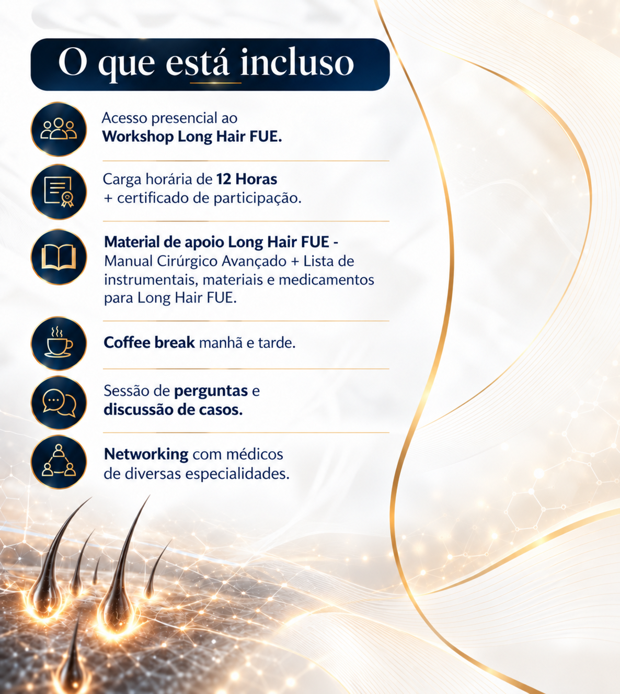

# Planejamento de nova landing page enxuta com copy e referências visuais

**Session ID:** ses_ea1948ea7ffeqzEbSSKR3ndxLR
**Created:** 10/21/2026, 9:24:22 AM
**Updated:** 10/22/2026, 1:06:00 PM

---

## User

mantenha essa suavização, mas altere a fonte para a mesma utilizada no CTA do cabeçalho - <a class="header-cta" href="#primeiro-lote" data-lead-modal-trigger="" aria-haspopup="dialog">Garanta a sua vaga agora</a>

---

## Assistant (Delegator-Agent · GPT-6 Luna · 26.6s)

_Thinking:_


**Tool: task**

**Input:**
```json
{
  "description": "Match CTA header font",
  "subagent_type": "dev-fronted",
  "prompt": "In standalone CSS, change only the direct purchase CTA `.button--purchase` font family to exactly match the existing header CTA `.header-cta` font family. Keep the softened font-weight 400, user's exact button text, href/color/behavior. Inspect cascade so it really matches. No root changes. Per standing instruction, no functional tests/SSE; do static CSS/diff check only. No deploy."
}
```

**Output:**
```
<task id="ses_e9fcc7362ffeCfLBxcRjoA4Umg" state="completed">
<task_result>
Updated only `.button--purchase` in `workshop-long-hair-fue-assets/styles.css` to use the same Inter/system font stack as `.header-cta` inherits from the standalone page’s root. Kept `font-weight: 400`, letter spacing, and all other CTA styling unchanged.

Static CSS/diff check: `git diff --check` passed. No functional tests or deployment performed.
</task_result>
</task>
```

---

## Assistant (Delegator-Agent · GPT-6 Luna · 2.7s)

O CTA de compra agora usa a mesma fonte do CTA do cabeçalho, mantendo o peso suavizado em 400. Texto, cor e destino foram preservados. A verificação estática passou; não rodei testes funcionais nem fiz deploy.

---

## User

coloque o peso da fonte de 400, para 450

---

## Assistant (Delegator-Agent · GPT-6 Luna · 18.3s)

_Thinking:_


**Tool: task**

**Input:**
```json
{
  "description": "Set CTA weight to 450",
  "subagent_type": "dev-fronted",
  "prompt": "Change only the standalone `.button--purchase` CSS font-weight from 400 to exactly 450. Preserve font family matching header CTA, text, href, color and behavior. Per standing instruction no functional tests/SSE; static inspect and diff check only. No deploy."
}
```

**Output:**
```
<task id="ses_e9fca9bc2ffe1pyTyUvGk4lf3G" state="completed">
<task_result>
Updated only the standalone `.button--purchase` rule in `workshop-long-hair-fue-assets/styles.css`: `font-weight` is now exactly `450`. Font family and all other styles, text, link, color, and behavior were left unchanged.

Static inspection and `git diff --check` completed. No functional tests or SSE run, and no deploy. The file is untracked in Git, so `git diff` did not show its change.
</task_result>
</task>
```

---

## Assistant (Delegator-Agent · GPT-6 Luna · 3.1s)

O peso da fonte do CTA foi alterado de **400 para 450**. A família, o texto, a cor e o destino do botão foram mantidos. Não rodei testes funcionais nem fiz deploy.

---

## User

no elemento : <div class="reserved-copy venue-reserved">ESPAÇO RESERVADO PARA INFORMAÇÕES CONFIRMADAS SOBRE INFRAESTRUTURA, HOTÉIS E ACESSO</div>
adicione a copy : O nosso workshop será realizado no Centro de Convenções Vogue Square, um dos espaços de eventos mais modernos e sofisticados da Barra da Tijuca, Rio de Janeiro.
Situado dentro de um complexo multiuso de alto padrão, o local combina uma infraestrutura tecnológica de ponta com o conforto de um polo que reúne gastronomia renomada, segurança e bem-estar.

Diferenciais do Espaço

• Ambiente Premium e Climatizado: Salão moderno com isolamento acústico e sistema de climatização planejado para garantir o máximo conforto durante toda a jornada de aprendizado.
• Acessibilidade Completa: O espaço conta com rampas, elevadores e total adaptação para pessoas com deficiência (PCD).
• Conectividade: Wi-Fi de alta velocidade disponível para que você possa acompanhar os materiais e interagir em tempo real. 
no elemento: <div class="reserved-media reserved-media--venue" role="img" aria-label="Espaço reservado para imagens verificadas do local e da Barra da Tijuca">
            <span>ESPAÇO RESERVADO PARA IMAGENS DO LOCAL / BARRA DA TIJUCA</span>
          </div> 
adicione a imagem: centro_convencao.jfif
no elemento : <dd>A inserir após confirmação</dd>
substitua o texto por : R$ 496.00
no elemento: <dd>A inserir após confirmação</dd>
Adicione a copy : 
Acesso presencial ao Workshop Long Hair FUE
Coffee Break manhã e tarde
Certificado de Participação
Manual Cirúrgico Avançado com lista de instrumentais, materiais e medicamentos para Long Hair Fue
Sessão de Perguntas e discussão de casos
Networking com médicos de diversas especialidades
No elemento <p>Aviso legal: [INSERIR TEXTO APROVADO]</p>
Chamar o agente de copy do time de marketing para inserir o aviso legal dizendo que todos os dados da página são exclusivos para o uso da campanha de marketing do workshop e que qualquer replicação ou informação utilizada de maneira não autorizada por terceiros estará sujeito a atos legais perante lei de plágio e a veiculação não autorizada de uso de imagem.  

Remover elemento:
<p class="offer-draft">Inscrição para o Workshop Long Hair FUE — Primeiro Lote.</p>
<p class="offer-draft">Garanta sua vaga no Primeiro Lote.</p>
<div><dt>Capacidade confirmada</dt><dd>A inserir após confirmação</dd></div>


---

## Assistant (Delegator-Agent · GPT-6 Luna · 15.4s)

_Thinking:_


_Thinking:_


**Tool: harness_plan**

**Input:**
```json
{
  "request": "Atualizar a dobra de local com copy e foto do Centro de Convenções; preencher preço e inclusões; remover copy draft e capacidade; chamar copywriter de marketing para elaborar aviso legal solicitado e inseri-lo.",
  "pipeline": "frontend"
}
```

**Output:**
```
# Harness v2

Project: `Dr. Patricia Veloso`
Session: `2026-10-22t11-55-03-945z-frontend`
Pipeline: `frontend` - Frontend, landing page, UI/UX, design web ou deploy web.
Session dir: `/home/ludy/projetos/Dr. Patricia Veloso/.opencode_harness/Dr. Patricia Veloso/2026-10-22t11-55-03-945z-frontend`
Storage: project-local hierarchical harness folder

## Stages
1. pm-project-developer - pending
2. dev-fronted - pending
3. sse-quality - pending

## Delegator Instruction
Use este plano como trilho operacional. Delegue cada etapa ao agente indicado, registre resultado com `harness_update` e pare se houver reprova apos 3 tentativas.
```

---

## Assistant (Delegator-Agent · GPT-6 Luna · 4.6s)

**Tool: todowrite**

**Input:**
```json
{
  "todos": [
    {
      "content": "Solicitar ao copywriter de marketing um aviso legal conciso com ressalva de revisão jurídica",
      "status": "in_progress",
      "priority": "high"
    },
    {
      "content": "Atualizar seção do local, preço, inclusões e remover conteúdo obsoleto na LP standalone",
      "status": "pending",
      "priority": "high"
    },
    {
      "content": "Inserir aviso legal aprovado pelo copywriter e validar estaticamente os arquivos alterados",
      "status": "pending",
      "priority": "high"
    }
  ]
}
```

**Output:**
```
[
  {
    "content": "Solicitar ao copywriter de marketing um aviso legal conciso com ressalva de revisão jurídica",
    "status": "in_progress",
    "priority": "high"
  },
  {
    "content": "Atualizar seção do local, preço, inclusões e remover conteúdo obsoleto na LP standalone",
    "status": "pending",
    "priority": "high"
  },
  {
    "content": "Inserir aviso legal aprovado pelo copywriter e validar estaticamente os arquivos alterados",
    "status": "pending",
    "priority": "high"
  }
]
```

---

## Assistant (Delegator-Agent · GPT-6 Luna · 435.5s)

**Tool: task**

**Input:**
```json
{
  "description": "Draft legal disclaimer copy",
  "subagent_type": "xq-copy-master-copy-master-chief",
  "prompt": "The user specifically asks to call the marketing copy agent to write a Portuguese legal notice for this workshop landing page. They want it to say that page data are exclusive for use in the Workshop Long Hair FUE marketing campaign, and any unauthorized replication/use of information or images may be subject to legal measures under applicable law (copyright/plagiarism and unauthorized image use). Draft concise, publish-ready Portuguese copy. Avoid overclaiming legal outcomes or stating that generic facts are protected by plagiarism law; distinguish protected text/creative assets and image rights. State this is copywriting, not legal advice, and recommend review by event counsel/holder of image rights before publication. Return exact paragraph text only plus a brief note on legal caveat."
}
```

**Output:**
```
<task id="ses_e9c88ce71ffeV7FkP68EvftFVZ" state="completed">
<task_result>
Os dados e materiais desta página destinam-se exclusivamente à campanha de divulgação do Workshop Long Hair FUE. A reprodução ou utilização não autorizada de textos, elementos criativos ou imagens poderá violar direitos autorais ou direitos de imagem e sujeitar os responsáveis às medidas cabíveis nos termos da legislação aplicável.

Nota: Este texto é uma sugestão de redação, não aconselhamento jurídico. Recomenda-se revisão pela assessoria jurídica do evento e pelo titular dos direitos de imagem antes da publicação.
</task_result>
</task>
```

**Tool: task**

**Input:**
```json
{
  "description": "Update venue and offer copy",
  "subagent_type": "dev-fronted",
  "prompt": "Implement the requested content updates ONLY in the standalone LP and its isolated assets; do not touch root files or unrelated dirty changes. Specifically:\n1) Replace the venue reserved copy `<div class=\"reserved-copy venue-reserved\">ESPAÇO RESERVADO PARA INFORMAÇÕES CONFIRMADAS SOBRE INFRAESTRUTURA, HOTÉIS E ACESSO</div>` with the exact venue text supplied by user: `O nosso workshop será realizado no Centro de Convenções Vogue Square, um dos espaços de eventos mais modernos e sofisticados da Barra da Tijuca, Rio de Janeiro. Situado dentro de um complexo multiuso de alto padrão, o local combina uma infraestrutura tecnológica de ponta com o conforto de um polo que reúne gastronomia renomada, segurança e bem-estar.` followed by heading `Diferenciais do Espaço` and these bullets verbatim: `Ambiente Premium e Climatizado: Salão moderno com isolamento acústico e sistema de climatização planejado para garantir o máximo conforto durante toda a jornada de aprendizado.`; `Acessibilidade Completa: O espaço conta com rampas, elevadores e total adaptação para pessoas com deficiência (PCD).`; `Conectividade: Wi-Fi de alta velocidade disponível para que você possa acompanhar os materiais e interagir em tempo real.`\n2) Replace the event price `<dd>A inserir após confirmação</dd>` (identify its `dt`) with exactly `R$ 496.00`.\n3) Replace the included-items placeholder `<dd>A inserir após confirmação</dd>` with a semantic list of these items verbatim: `Acesso presencial ao Workshop Long Hair FUE`; `Coffee Break manhã e tarde`; `Certificado de Participação`; `Manual Cirúrgico Avançado com lista de instrumentais, materiais e medicamentos para Long Hair Fue`; `Sessão de Perguntas e discussão de casos`; `Networking com médicos de diversas especialidades`.\n4) Remove exactly these obsolete elements: `<p class=\"offer-draft\">Inscrição para o Workshop Long Hair FUE — Primeiro Lote.</p>`, `<p class=\"offer-draft\">Garanta sua vaga no Primeiro Lote.</p>`, and the `div` whose dt is `Capacidade confirmada`.\n5) Replace venue reserved-image block with the local `centro_convencao.jfif` if present in project or user assets; inspect exact name/location/case, copy into isolated `workshop-long-hair-fue-assets/img/` if needed (don't reference root paths), preserve aspect ratio and descriptive alt. If absent, leave the image slot blank and report that asset is missing; do not fabricate/use unrelated venue imagery.\nDo NOT write the legal notice yet; it will be supplied by marketing copywriter. Keep legal placeholder until then. Preserve CTA, checkout, five folds, header, FAQ, all other structure. Do not run functional tests or SSE; static validation only per user instruction: parse HTML, exact text/duplicate check, local asset paths, JS syntax only if touched, `git diff --check`. No deploy. Return exact files, image status, static checks."
}
```

**Output:**
```
<task id="ses_e9c88ce1fffeqswXQeKOIe3zAG" state="completed">
<task_result>
Updated only `workshop-long-hair-fue.html` with the requested venue copy and semantic bullets, price (`R$ 496.00`), included-items list, and removal of the two offer-draft paragraphs and “Capacidade confirmada” entry. The legal placeholder remains unchanged.

**Venue image:** `centro_convencao.jfif` was not present. I found only `workshop-long-hair-fue-assets/img/centro_convecao.jfif`—a differently spelled filename—and did not use it. The venue image slot is blank.

**Static checks:** HTML parsed successfully; requested text appears exactly once; obsolete content is absent; legal placeholder is preserved; all 10 referenced isolated asset paths resolve; `git diff --check` passed. No functional tests or deployment were run.
</task_result>
</task>
```

---

## Assistant (Delegator-Agent · GPT-6 Luna · 86.0s)

_Thinking:_


_Thinking:_


A copy do aviso legal foi preparada pelo agente de marketing. A imagem solicitada não apareceu com esse nome exato, mas encontrei um arquivo com nome quase igual; vou verificar se ele realmente mostra o local antes de usá-lo, para não inserir uma imagem errada.

**Tool: task**

**Input:**
```json
{
  "description": "Insert legal copy and verify venue image",
  "subagent_type": "dev-fronted",
  "prompt": "Complete the remaining requested elements on the standalone LP only. Legal text from marketing copywriter (insert this paragraph in place of `<p>Aviso legal: [INSERIR TEXTO APROVADO]</p>`): `Os dados e materiais desta página destinam-se exclusivamente à campanha de divulgação do Workshop Long Hair FUE. A reprodução ou utilização não autorizada de textos, elementos criativos ou imagens poderá violar direitos autorais ou direitos de imagem e sujeitar os responsáveis às medidas cabíveis nos termos da legislação aplicável.` Do not insert the writer's internal note as page content; flag in report that copy is not legal advice and should be reviewed by event counsel/rightsholders.\n\nVenue image: user requested `centro_convencao.jfif`, but prior inspection found `workshop-long-hair-fue-assets/img/centro_convecao.jfif` (misspelled). Inspect that actual image visually. If it clearly depicts the named Centro de Convenções/Vogue Square location, copy it into isolated assets under corrected desired filename `centro_convencao.jfif` and use it in the existing venue image element with accurate dimensions/alt and preserved aspect ratio. If it does not clearly depict that venue, do not use it and leave the reserved venue image blank; report why. Do not use other imagery. Keep price/list/removals/CTA/five fold structure. Do not touch root/unrelated files. No functional tests/SSE; static validation only of HTML, image paths/dimensions, duplicates, five folds, direct CTA and diff check. No deploy."
}
```

**Output:**
```
<task id="ses_e9c8222aaffeoAhdoNITlMolJg" state="completed">
<task_result>
Updated only the standalone LP:

- Replaced the legal placeholder with the supplied paragraph. The writer’s internal note was not added to the page.
- The provided image visibly identifies **VOGUE SQUARE**, so I copied it to `workshop-long-hair-fue-assets/img/centro_convencao.jfif` and used it in the venue section. The image is 1200 × 900, has matching width/height attributes, descriptive alt text, and retains its aspect ratio.

Static validation confirmed the HTML parses, the five-fold structure remains intact, the image path resolves with one reference, the approved legal text appears once, the placeholder is gone, and the direct purchase CTA remains. `git diff --check` passed. No functional tests or deployment were run.

**Review note:** This copy is not legal advice; event counsel and the relevant rightsholders should review it.
</task_result>
</task>
```

---

## Assistant (Delegator-Agent · GPT-6 Luna · 4.7s)

_Thinking:_


**Tool: harness_update**

**Input:**
```json
{
  "agent": "xq-copy-master-copy-master-chief",
  "status": "passed",
  "score": 9,
  "artifacts": [],
  "findings": [
    "Aviso redigido para não afirmar que fatos genéricos são protegidos por plágio; refere-se a textos, elementos criativos e imagens, e recomenda revisão jurídica."
  ],
  "notes": "Copywriter elaborou aviso legal em português com caveat de revisão por assessoria jurídica/titular de direitos."
}
```

**Output:**
```
Stage not found for agent: xq-copy-master-copy-master-chief
```

---

## Assistant (Delegator-Agent · GPT-6 Luna · 5.4s)

_Thinking:_


**Tool: harness_update**

**Input:**
```json
{
  "agent": "dev-fronted",
  "status": "passed",
  "score": 9,
  "artifacts": [
    "workshop-long-hair-fue.html",
    "workshop-long-hair-fue-assets/img/centro_convencao.jfif"
  ],
  "findings": [
    "O texto do aviso legal é copy editorial, não aconselhamento jurídico; recomenda-se revisão por counsel do evento e titulares de direitos."
  ],
  "notes": "Seção de local recebeu copy fornecida, preço R$ 496.00, lista de itens incluídos, remoções solicitadas; legal placeholder substituído por copywriter. Imagem com nome original discrepante foi inspecionada e confirmou VOGUE SQUARE; copiada para assets isolados com filename solicitado. Validação estática; sem testes funcionais/deploy."
}
```

**Output:**
```
{
  "stateFile": "/home/ludy/projetos/Dr. Patricia Veloso/.opencode_harness/Dr. Patricia Veloso/2026-10-22t11-55-03-945z-frontend/state.json",
  "sessionDir": "/home/ludy/projetos/Dr. Patricia Veloso/.opencode_harness/Dr. Patricia Veloso/2026-10-22t11-55-03-945z-frontend",
  "status": "IN_PROGRESS",
  "updated": {
    "timestamp": "2026-10-22T12:04:00.080Z",
    "type": "update",
    "sessionId": "2026-10-22t11-55-03-945z-frontend",
    "stageIndex": 1,
    "agent": "dev-fronted",
    "status": "passed",
    "score": 9,
    "artifacts": [
      "workshop-long-hair-fue.html",
      "workshop-long-hair-fue-assets/img/centro_convencao.jfif"
    ],
    "findings": [
      "O texto do aviso legal é copy editorial, não aconselhamento jurídico; recomenda-se revisão por counsel do evento e titulares de direitos."
    ],
    "notes": "Seção de local recebeu copy fornecida, preço R$ 496.00, lista de itens incluídos, remoções solicitadas; legal placeholder substituído por copywriter. Imagem com nome original discrepante foi inspecionada e confirmou VOGUE SQUARE; copiada para assets isolados com filename solicitado. Validação estática; sem testes funcionais/deploy."
  }
}
```

---

## Assistant (Delegator-Agent · GPT-6 Luna · 3.8s)

**Tool: harness_update**

**Input:**
```json
{
  "agent": "pm-project-developer",
  "status": "skipped",
  "notes": "Copy e conteúdo fornecidos diretamente; apenas execução e validação estática solicitadas."
}
```

**Output:**
```
{
  "stateFile": "/home/ludy/projetos/Dr. Patricia Veloso/.opencode_harness/Dr. Patricia Veloso/2026-10-22t11-55-03-945z-frontend/state.json",
  "sessionDir": "/home/ludy/projetos/Dr. Patricia Veloso/.opencode_harness/Dr. Patricia Veloso/2026-10-22t11-55-03-945z-frontend",
  "status": "IN_PROGRESS",
  "updated": {
    "timestamp": "2026-10-22T12:04:04.020Z",
    "type": "update",
    "sessionId": "2026-10-22t11-55-03-945z-frontend",
    "stageIndex": 0,
    "agent": "pm-project-developer",
    "status": "skipped",
    "score": null,
    "artifacts": [],
    "findings": [],
    "notes": "Copy e conteúdo fornecidos diretamente; apenas execução e validação estática solicitadas."
  }
}
```

---

## Assistant (Delegator-Agent · GPT-6 Luna · 3.7s)

**Tool: harness_update**

**Input:**
```json
{
  "agent": "sse-quality",
  "status": "skipped",
  "findings": [
    "Usuária mantém testes funcionais; gate SSE não solicitado."
  ],
  "notes": "Validação estática e código revisado pelo dev-fronted. Sem teste funcional/deploy."
}
```

**Output:**
```
{
  "stateFile": "/home/ludy/projetos/Dr. Patricia Veloso/.opencode_harness/Dr. Patricia Veloso/2026-10-22t11-55-03-945z-frontend/state.json",
  "sessionDir": "/home/ludy/projetos/Dr. Patricia Veloso/.opencode_harness/Dr. Patricia Veloso/2026-10-22t11-55-03-945z-frontend",
  "status": "APPROVED",
  "updated": {
    "timestamp": "2026-10-22T12:04:07.496Z",
    "type": "update",
    "sessionId": "2026-10-22t11-55-03-945z-frontend",
    "stageIndex": 2,
    "agent": "sse-quality",
    "status": "skipped",
    "score": null,
    "artifacts": [],
    "findings": [
      "Usuária mantém testes funcionais; gate SSE não solicitado."
    ],
    "notes": "Validação estática e código revisado pelo dev-fronted. Sem teste funcional/deploy."
  }
}
```

---

## Assistant (Delegator-Agent · GPT-6 Luna · 4.4s)

_Thinking:_


**Tool: todowrite**

**Input:**
```json
{
  "todos": [
    {
      "content": "Solicitar ao copywriter de marketing um aviso legal conciso com ressalva de revisão jurídica",
      "status": "completed",
      "priority": "high"
    },
    {
      "content": "Atualizar seção do local, preço, inclusões e remover conteúdo obsoleto na LP standalone",
      "status": "completed",
      "priority": "high"
    },
    {
      "content": "Inserir aviso legal aprovado pelo copywriter e validar estaticamente os arquivos alterados",
      "status": "completed",
      "priority": "high"
    }
  ]
}
```

**Output:**
```
[
  {
    "content": "Solicitar ao copywriter de marketing um aviso legal conciso com ressalva de revisão jurídica",
    "status": "completed",
    "priority": "high"
  },
  {
    "content": "Atualizar seção do local, preço, inclusões e remover conteúdo obsoleto na LP standalone",
    "status": "completed",
    "priority": "high"
  },
  {
    "content": "Inserir aviso legal aprovado pelo copywriter e validar estaticamente os arquivos alterados",
    "status": "completed",
    "priority": "high"
  }
]
```

---

## Assistant (Delegator-Agent · GPT-6 Luna · 4.5s)

Atualizei a dobra do local com o texto e os diferenciais enviados, adicionei a imagem do Vogue Square e copiei o arquivo para a pasta isolada de assets como `centro_convencao.jfif`. O arquivo original tinha uma grafia diferente, mas a imagem foi conferida visualmente e identifica o Vogue Square.

Também atualizei o preço para **R$ 496.00**, substituí o espaço de inclusões pela lista enviada e removi os dois textos de oferta e o campo de capacidade confirmada. O aviso legal foi redigido pelo copywriter e inserido no lugar do placeholder.

A revisão foi estática; não rodei testes funcionais nem fiz deploy. Recomendo revisão jurídica do aviso antes da publicação.

---

## User

no local do video, utilizaremos um link externo do youtube, pois, no vercel nao e possivel carrega-lo devido o seu tamanho, por isso, substitua o carregamento dele que estaria para o arquivo local para o link https://youtube.com/shorts/NOwurKAoI8w mantendo a capa do video da mesma maneira que esta montado 

---

## Assistant (Delegator-Agent · GPT-6 Luna · 6.0s)

_Thinking:_


**Tool: harness_plan**

**Input:**
```json
{
  "request": "Substituir reprodução local do vídeo do hero por link externo do YouTube Shorts `https://youtube.com/shorts/NOwurKAoI8w`, preservando a capa e o botão central de play; não carregar o MP4 do Vercel.",
  "pipeline": "frontend"
}
```

**Output:**
```
# Harness v2

Project: `Dr. Patricia Veloso`
Session: `2026-10-22t12-10-25-559z-frontend`
Pipeline: `frontend` - Frontend, landing page, UI/UX, design web ou deploy web.
Session dir: `/home/ludy/projetos/Dr. Patricia Veloso/.opencode_harness/Dr. Patricia Veloso/2026-10-22t12-10-25-559z-frontend`
Storage: project-local hierarchical harness folder

## Stages
1. pm-project-developer - pending
2. dev-fronted - pending
3. sse-quality - pending

## Delegator Instruction
Use este plano como trilho operacional. Delegue cada etapa ao agente indicado, registre resultado com `harness_update` e pare se houver reprova apos 3 tentativas.
```

---

## Assistant (Delegator-Agent · GPT-6 Luna · 53.0s)

**Tool: task**

**Input:**
```json
{
  "description": "Switch hero to YouTube Shorts",
  "subagent_type": "dev-fronted",
  "prompt": "Update standalone hero video to use the external YouTube Shorts URL `https://youtube.com/shorts/NOwurKAoI8w` instead of loading the local `video_workshop.mp4`, while keeping the current cover image (`capa_video.jpeg`) and centered Play overlay exactly as the visual entry point. On Play click, embed/play the YouTube video (convert to supported embed URL using ID NOwurKAoI8w; use privacy-enhanced `youtube-nocookie.com/embed/NOwurKAoI8w` if suitable, with autoplay=1 and playsinline=1). Do not load the local MP4 at runtime. Preserve accessible label/status, keep fallback/controls appropriate for iframe, and only initialize external iframe after user clicks to avoid loading YouTube prematurely. Keep the cover visible until playback starts/iframe is inserted, maintain responsive portrait aspect ratio. Remove/disable old local `video.play()` event logic that would conflict; remove local video file from required-runtime references but do not delete it from repository unless explicitly required. Do not change unrelated/root files. Per user's standing instruction, no functional tests or SSE; static validation only (markup, JS syntax, URL/ID, poster path, no local MP4 reference in runtime HTML/JS, diff check). No deploy. Report whether local MP4 can now be excluded from Git upload."
}
```

**Output:**
```
<task id="ses_e9c7ae152ffexkjl06N25QJn6Q" state="completed">
<task_result>
Atualizei o vídeo hero standalone:

- A capa `capa_video.jpeg` e o botão Play centralizado permanecem como entrada visual.
- O YouTube só é incorporado após o clique, usando `youtube-nocookie.com/embed/NOwurKAoI8w?autoplay=1&playsinline=1`. A capa fica visível até o iframe ser inserido; depois, os controles do YouTube ficam disponíveis.
- Removi a lógica antiga de `video.play()` e mantive rótulos acessíveis e status para o player.
- Ajustei o layout para manter a proporção retrato responsiva.

**Validação estática:** `node --check` e `git diff --check` passaram. Confirmei também o ID/URL e o caminho do poster, e não há referência ao MP4 no HTML/JS runtime. Não executei testes funcionais nem SSE, conforme solicitado; não fiz deploy.

**O MP4 local pode ser excluído do upload ao Git**, desde que nenhum outro processo externo dependa dele. Não o removi do repositório.
</task_result>
</task>
```

---

## Assistant (Delegator-Agent · GPT-6 Luna · 3.9s)

_Thinking:_


**Tool: harness_update**

**Input:**
```json
{
  "agent": "dev-fronted",
  "status": "passed",
  "score": 9,
  "artifacts": [
    "workshop-long-hair-fue.html",
    "workshop-long-hair-fue-assets/script.js",
    "workshop-long-hair-fue-assets/styles.css"
  ],
  "notes": "Substituído player local por iframe YouTube embed após clique (youtube-nocookie embed ID NOwurKAoI8w). Capa e botão Play preservados. Sem referência runtime ao MP4 local; estático node check, diff check e URLs. Sem E2E/SSE/deploy."
}
```

**Output:**
```
{
  "stateFile": "/home/ludy/projetos/Dr. Patricia Veloso/.opencode_harness/Dr. Patricia Veloso/2026-10-22t12-10-25-559z-frontend/state.json",
  "sessionDir": "/home/ludy/projetos/Dr. Patricia Veloso/.opencode_harness/Dr. Patricia Veloso/2026-10-22t12-10-25-559z-frontend",
  "status": "IN_PROGRESS",
  "updated": {
    "timestamp": "2026-10-22T12:11:22.655Z",
    "type": "update",
    "sessionId": "2026-10-22t12-10-25-559z-frontend",
    "stageIndex": 1,
    "agent": "dev-fronted",
    "status": "passed",
    "score": 9,
    "artifacts": [
      "workshop-long-hair-fue.html",
      "workshop-long-hair-fue-assets/script.js",
      "workshop-long-hair-fue-assets/styles.css"
    ],
    "findings": [],
    "notes": "Substituído player local por iframe YouTube embed após clique (youtube-nocookie embed ID NOwurKAoI8w). Capa e botão Play preservados. Sem referência runtime ao MP4 local; estático node check, diff check e URLs. Sem E2E/SSE/deploy."
  }
}
```

---

## Assistant (Delegator-Agent · GPT-6 Luna · 3.7s)

**Tool: harness_update**

**Input:**
```json
{
  "agent": "pm-project-developer",
  "status": "skipped",
  "notes": "Substituição pontual de mídia conforme instrução direta."
}
```

**Output:**
```
{
  "stateFile": "/home/ludy/projetos/Dr. Patricia Veloso/.opencode_harness/Dr. Patricia Veloso/2026-10-22t12-10-25-559z-frontend/state.json",
  "sessionDir": "/home/ludy/projetos/Dr. Patricia Veloso/.opencode_harness/Dr. Patricia Veloso/2026-10-22t12-10-25-559z-frontend",
  "status": "IN_PROGRESS",
  "updated": {
    "timestamp": "2026-10-22T12:11:26.436Z",
    "type": "update",
    "sessionId": "2026-10-22t12-10-25-559z-frontend",
    "stageIndex": 0,
    "agent": "pm-project-developer",
    "status": "skipped",
    "score": null,
    "artifacts": [],
    "findings": [],
    "notes": "Substituição pontual de mídia conforme instrução direta."
  }
}
```

---

## Assistant (Delegator-Agent · GPT-6 Luna · 3.2s)

**Tool: harness_update**

**Input:**
```json
{
  "agent": "sse-quality",
  "status": "skipped",
  "notes": "Sem testes funcionais/gate SSE por instrução da usuária."
}
```

**Output:**
```
{
  "stateFile": "/home/ludy/projetos/Dr. Patricia Veloso/.opencode_harness/Dr. Patricia Veloso/2026-10-22t12-10-25-559z-frontend/state.json",
  "sessionDir": "/home/ludy/projetos/Dr. Patricia Veloso/.opencode_harness/Dr. Patricia Veloso/2026-10-22t12-10-25-559z-frontend",
  "status": "APPROVED",
  "updated": {
    "timestamp": "2026-10-22T12:11:29.613Z",
    "type": "update",
    "sessionId": "2026-10-22t12-10-25-559z-frontend",
    "stageIndex": 2,
    "agent": "sse-quality",
    "status": "skipped",
    "score": null,
    "artifacts": [],
    "findings": [],
    "notes": "Sem testes funcionais/gate SSE por instrução da usuária."
  }
}
```

---

## Assistant (Delegator-Agent · GPT-6 Luna · 5.0s)

O hero agora carrega o YouTube somente depois do clique em Play, usando o vídeo `NOwurKAoI8w`. A capa e o botão central foram mantidos; o MP4 local não é mais necessário para a LP e pode ficar fora do upload ao Git, desde que nenhum outro processo dependa dele.

Fiz validações estáticas do código e dos caminhos. Não rodei testes funcionais nem fiz deploy.

---

## User

carregue a pagina em local para eu analisar como ficou 

---

## Assistant (Delegator-Agent · GPT-6 Luna · 40.5s)

_Thinking:_


**Tool: task**

**Input:**
```json
{
  "description": "Start local LP preview",
  "subagent_type": "dev-fronted",
  "prompt": "Start or reuse a local static preview server for the current standalone page so the user can inspect the latest version, including YouTube click-to-embed. Use project root, avoid changing files, no deploy, no functional tests. Return exact URL (prefer http://localhost:4173/workshop-long-hair-fue.html), confirm HTTP 200, and exact command to stop the server. If an existing preview on 4173 is still running, use it; otherwise start a persistent server."
}
```

**Output:**
```
<task id="ses_e9c6372d7ffeiJNPSoOwFE30eT" state="completed">
<task_result>
Static preview is running from the project root.

- **URL:** http://localhost:4173/workshop-long-hair-fue.html
- **HTTP status:** 200
- **Stop command:** `kill 18520`

No files were changed, no functional tests were run, and nothing was deployed.
</task_result>
</task>
```

---

## Assistant (Delegator-Agent · GPT-6 Luna · 4.0s)

A versão atual está carregada para você analisar em [http://localhost:4173/workshop-long-hair-fue.html](http://localhost:4173/workshop-long-hair-fue.html).

O servidor respondeu **HTTP 200**. Para encerrá-lo: `kill 18520`.

---

## User

simplificaremos o video, altere todo o procedimento que realizamos e apenas adicione o codigo de incorporação fornecido pela Vimeo no local onde esta na nossa pagina :
<div style="padding:177.78% 0 0 0;position:relative;"><iframe src="https://player.vimeo.com/video/1238362022?badge=0&amp;autopause=0&amp;player_id=0&amp;app_id=58479" frameborder="0" allow="autoplay; fullscreen; picture-in-picture; clipboard-write; encrypted-media; web-share" referrerpolicy="strict-origin-when-cross-origin" style="position:absolute;top:0;left:0;width:100%;height:100%;" title="Workshop Long Hair FUE - RIO"></iframe></div><script src="https://player.vimeo.com/api/player.js"></script> 

---

## Assistant (Delegator-Agent · GPT-6 Luna · 5.3s)

_Thinking:_


**Tool: harness_plan**

**Input:**
```json
{
  "request": "Substituir toda implementação atual de vídeo do hero pelo código de incorporação fornecido pelo Vimeo, inserido diretamente no local atual do vídeo.",
  "pipeline": "frontend"
}
```

**Output:**
```
# Harness v2

Project: `Dr. Patricia Veloso`
Session: `2026-10-22t12-59-29-595z-frontend`
Pipeline: `frontend` - Frontend, landing page, UI/UX, design web ou deploy web.
Session dir: `/home/ludy/projetos/Dr. Patricia Veloso/.opencode_harness/Dr. Patricia Veloso/2026-10-22t12-59-29-595z-frontend`
Storage: project-local hierarchical harness folder

## Stages
1. pm-project-developer - pending
2. dev-fronted - pending
3. sse-quality - pending

## Delegator Instruction
Use este plano como trilho operacional. Delegue cada etapa ao agente indicado, registre resultado com `harness_update` e pare se houver reprova apos 3 tentativas.
```

---

## Assistant (Delegator-Agent · GPT-6 Luna · 73.4s)

**Tool: task**

**Input:**
```json
{
  "description": "Replace hero with Vimeo embed",
  "subagent_type": "dev-fronted",
  "prompt": "Replace the entire current hero video implementation with exactly the Vimeo embed code supplied by user, inserted at the existing video location in standalone LP. Remove the local-video/YouTube play overlay procedures, button markup, poster behavior and related JS handlers/CSS if no longer used. Do not keep two player systems or add a custom poster; use the Vimeo embed as provided. Ensure `player.js` is included once only. Preserve surrounding hero/five-fold structure and do not change root/unrelated files.\n\nUser-provided code:\n`<div style=\"padding:177.78% 0 0 0;position:relative;\"><iframe src=\"https://player.vimeo.com/video/1238362022?badge=0&amp;autopause=0&amp;player_id=0&amp;app_id=58479\" frameborder=\"0\" allow=\"autoplay; fullscreen; picture-in-picture; clipboard-write; encrypted-media; web-share\" referrerpolicy=\"strict-origin-when-cross-origin\" style=\"position:absolute;top:0;left:0;width:100%;height:100%;\" title=\"Workshop Long Hair FUE - RIO\"></iframe></div><script src=\"https://player.vimeo.com/api/player.js\"></script>`\n\nPer user's standing preference, do not run functional tests or SSE; static check only: one Vimeo iframe, one player.js include, no old YouTube/local video handlers or stale markup, HTML syntax / diff check, and no root files modified. No deployment. Report exact files changed."
}
```

**Output:**
```
<task id="ses_e9c4df2f5ffe7faR6sov6R2e0b" state="completed">
<task_result>
Replaced the standalone LP’s hero video with the supplied Vimeo embed, preserving its location and surrounding hero/five-fold structure. Removed the old poster, play button, YouTube handler, and related styles. The Vimeo `player.js` include appears once.

**Files changed**
- `workshop-long-hair-fue.html`
- `workshop-long-hair-fue-assets/script.js`
- `workshop-long-hair-fue-assets/styles.css`

**Static checks:** HTML parser passed; confirmed one Vimeo iframe and one `player.js` include; no legacy video handlers or markup found in the LP assets; `git diff --check` passed. No functional tests, SSE, or deployment performed.

The worktree already contained unrelated modifications and untracked files; I did not change root files.
</task_result>
</task>
```

---

## Assistant (Delegator-Agent · GPT-6 Luna · 4.2s)

_Thinking:_


**Tool: harness_update**

**Input:**
```json
{
  "agent": "dev-fronted",
  "status": "passed",
  "score": 9,
  "artifacts": [
    "workshop-long-hair-fue.html",
    "workshop-long-hair-fue-assets/script.js",
    "workshop-long-hair-fue-assets/styles.css"
  ],
  "notes": "Hero switched to supplied Vimeo embed. Removed YouTube/local video/poster/custom-play logic/styles; player.js only once. Static HTML/diff checks passed, no functional suite/SSE/deploy."
}
```

**Output:**
```
{
  "stateFile": "/home/ludy/projetos/Dr. Patricia Veloso/.opencode_harness/Dr. Patricia Veloso/2026-10-22t12-59-29-595z-frontend/state.json",
  "sessionDir": "/home/ludy/projetos/Dr. Patricia Veloso/.opencode_harness/Dr. Patricia Veloso/2026-10-22t12-59-29-595z-frontend",
  "status": "IN_PROGRESS",
  "updated": {
    "timestamp": "2026-10-22T13:00:47.538Z",
    "type": "update",
    "sessionId": "2026-10-22t12-59-29-595z-frontend",
    "stageIndex": 1,
    "agent": "dev-fronted",
    "status": "passed",
    "score": 9,
    "artifacts": [
      "workshop-long-hair-fue.html",
      "workshop-long-hair-fue-assets/script.js",
      "workshop-long-hair-fue-assets/styles.css"
    ],
    "findings": [],
    "notes": "Hero switched to supplied Vimeo embed. Removed YouTube/local video/poster/custom-play logic/styles; player.js only once. Static HTML/diff checks passed, no functional suite/SSE/deploy."
  }
}
```

---

## Assistant (Delegator-Agent · GPT-6 Luna · 4.3s)

**Tool: harness_update**

**Input:**
```json
{
  "agent": "pm-project-developer",
  "status": "skipped",
  "notes": "Substituição direta de código de embed fornecido."
}
```

**Output:**
```
{
  "stateFile": "/home/ludy/projetos/Dr. Patricia Veloso/.opencode_harness/Dr. Patricia Veloso/2026-10-22t12-59-29-595z-frontend/state.json",
  "sessionDir": "/home/ludy/projetos/Dr. Patricia Veloso/.opencode_harness/Dr. Patricia Veloso/2026-10-22t12-59-29-595z-frontend",
  "status": "IN_PROGRESS",
  "updated": {
    "timestamp": "2026-10-22T13:00:51.815Z",
    "type": "update",
    "sessionId": "2026-10-22t12-59-29-595z-frontend",
    "stageIndex": 0,
    "agent": "pm-project-developer",
    "status": "skipped",
    "score": null,
    "artifacts": [],
    "findings": [],
    "notes": "Substituição direta de código de embed fornecido."
  }
}
```

---

## Assistant (Delegator-Agent · GPT-6 Luna · 4.8s)

**Tool: harness_update**

**Input:**
```json
{
  "agent": "sse-quality",
  "status": "skipped",
  "notes": "Funcional acceptance tests by user; static checks only as previously requested."
}
```

**Output:**
```
{
  "stateFile": "/home/ludy/projetos/Dr. Patricia Veloso/.opencode_harness/Dr. Patricia Veloso/2026-10-22t12-59-29-595z-frontend/state.json",
  "sessionDir": "/home/ludy/projetos/Dr. Patricia Veloso/.opencode_harness/Dr. Patricia Veloso/2026-10-22t12-59-29-595z-frontend",
  "status": "APPROVED",
  "updated": {
    "timestamp": "2026-10-22T13:00:56.724Z",
    "type": "update",
    "sessionId": "2026-10-22t12-59-29-595z-frontend",
    "stageIndex": 2,
    "agent": "sse-quality",
    "status": "skipped",
    "score": null,
    "artifacts": [],
    "findings": [],
    "notes": "Funcional acceptance tests by user; static checks only as previously requested."
  }
}
```

---

## Assistant (Delegator-Agent · GPT-6 Luna · 5.5s)

Substituí a implementação anterior do vídeo pelo embed do Vimeo no mesmo local do hero. Removi o player local, a integração com YouTube, a capa e o botão Play personalizado; o script do Vimeo aparece uma única vez.

A validação foi estática. Não rodei testes funcionais nem fiz deploy.

---

## User

dimensionar a imagem com o tamanho que foi separado na classe   , crie uma borda arredondada também nela 

---

## Assistant (Delegator-Agent · GPT-6 Luna · 46.9s)

_Thinking:_


**Tool: task**

**Input:**
```json
{
  "description": "Size and round venue image",
  "subagent_type": "dev-fronted",
  "prompt": "On standalone LP only, adjust the venue image `` to occupy the dimensions/layout space allocated by `.reserved-media--venue` while preserving aspect ratio (do not distort; use responsive width/max dimensions and object-fit only if appropriate). Add rounded corners consistent with the page (border-radius). Keep lazy loading, decoding, alt text and source intact. Do not touch root/unrelated files. Per user's standing preference, no functional tests/SSE; static CSS/HTML review and diff check only. No deploy."
}
```

**Output:**
```
<task id="ses_e9c3511d9ffesZury4bg5pau5r" state="completed">
<task_result>
Updated only the standalone LP stylesheet: `.reserved-media--venue` now scales responsively up to `37.5rem × 28.125rem`, keeps its natural aspect ratio with `height: auto`, and has rounded corners. The image markup—including its source, alt text, lazy loading, and decoding—remains unchanged.

Static review and `git diff --check` completed. No functional tests, SSE review, or deploy were run.
</task_result>
</task>
```

---

## Assistant (Delegator-Agent · GPT-6 Luna · 3.8s)

Ajustei a imagem do local para ocupar o espaço reservado de forma responsiva, preservando a proporção original, e adicionei bordas arredondadas. Mantive o caminho, o texto alternativo e os atributos de carregamento. Não rodei testes funcionais nem fiz deploy.

---

## User

remova o grind atrás da imagem  pois ainda está a imagem pequena. Deixe apenas a imagem com a moldura 

---

## Assistant (Delegator-Agent · GPT-6 Luna · 30.7s)

_Thinking:_


**Tool: task**

**Input:**
```json
{
  "description": "Remove venue image grid frame",
  "subagent_type": "dev-fronted",
  "prompt": "Fix the standalone venue image presentation: remove the decorative grid/background/frame behind the photo so only the image itself with its rounded border remains. The image currently appears too small; make the image itself fill the available content width (width:100%; max-width: none or appropriate full container) while preserving natural 4:3 aspect ratio, no distortion, with rounded corners on the image. Remove any pseudo-element/grid/background styling specific to `.reserved-media--venue` that renders behind it; keep the venue image element and caption/alt as appropriate. Do not alter other reserved-media blocks or root files. Per standing preference no functional tests/SSE; static CSS/HTML review and diff check only. No deploy."
}
```

**Output:**
```
<task id="ses_e9c1b6ad2ffeHGcYJ4JNR77FqP" state="completed">
<task_result>
Updated `.reserved-media--venue` so the photo fills its content width, keeps a natural 4:3 ratio without distortion, and has rounded corners. Removed its reserved-media frame and grid background while leaving the image element, alt text, and other reserved-media styles unchanged.

**Verification:** `git diff --check` passed. No functional tests, SSE review, or deployment performed. The venue stylesheet is inside the untracked `workshop-long-hair-fue-assets/` directory; the working tree also contains unrelated existing changes.
</task_result>
</task>
```

---

## Assistant (Delegator-Agent · GPT-6 Luna · 5.8s)

Removi o fundo em grade atrás da foto e ajustei a imagem para preencher a largura disponível, mantendo a proporção 4:3 e os cantos arredondados. A imagem e o texto alternativo foram mantidos. Não rodei testes funcionais nem fiz deploy.

---

## User

remover essa div  - <div class="benefit-list">
              <article class="benefit"><h3>Hands-on/Observação de perto</h3><div class="reserved-copy" aria-label="Espaço reservado para texto aprovado">Texto aprovado a inserir</div></article>
              <article class="benefit"><h3>Networking</h3><div class="reserved-copy" aria-label="Espaço reservado para texto aprovado">Texto aprovado a inserir</div></article>
              <article class="benefit"><h3>Experiência Premium</h3><div class="reserved-copy" aria-label="Espaço reservado para texto aprovado">Texto aprovado a inserir</div></article>
            </div> 
alterar as informações do elemento - <h2 id="venue-title">O Local do Evento (Barra da Tijuca)</h2>
por : Centro de Convenções Vogue Square - Barra da Tijuca
remover elemento: <p>Centro de Convenções Vogue Square</p>
inserir CNPJ no elemento - <p>CNPJ: [INSERIR CNPJ]</p>
CNPJ: 34.748.604/0001-32
Alterar elemento: <dl class="offer-placeholders">
            <div><dt>Valor e condições do primeiro lote</dt><dd>R$ 496.00</dd></div>
            <div><dt>Itens incluídos</dt><dd><ul>
              <li>Acesso presencial ao Workshop Long Hair FUE</li>
              <li>Coffee Break manhã e tarde</li>
              <li>Certificado de Participação</li>
              <li>Manual Cirúrgico Avançado com lista de instrumentais, materiais e medicamentos para Long Hair Fue</li>
              <li>Sessão de Perguntas e discussão de casos</li>
              <li>Networking com médicos de diversas especialidades</li>
            </ul></dd></div>
          </dl> 
pela imagem: incluso.pnj

---

## Assistant (Delegator-Agent · GPT-6 Luna · 6.0s)

_Thinking:_


**Tool: harness_plan**

**Input:**
```json
{
  "request": "Remover benefit-list; ajustar título e texto duplicado do local; preencher CNPJ; substituir lista de oferta pela imagem incluso (identificar extensão correta).",
  "pipeline": "frontend"
}
```

**Output:**
```
# Harness v2

Project: `Dr. Patricia Veloso`
Session: `2026-10-22t14-08-41-762z-frontend`
Pipeline: `frontend` - Frontend, landing page, UI/UX, design web ou deploy web.
Session dir: `/home/ludy/projetos/Dr. Patricia Veloso/.opencode_harness/Dr. Patricia Veloso/2026-10-22t14-08-41-762z-frontend`
Storage: project-local hierarchical harness folder

## Stages
1. pm-project-developer - pending
2. dev-fronted - pending
3. sse-quality - pending

## Delegator Instruction
Use este plano como trilho operacional. Delegue cada etapa ao agente indicado, registre resultado com `harness_update` e pare se houver reprova apos 3 tentativas.
```

---

## Assistant (Delegator-Agent · GPT-6 Luna · 58.0s)

**Tool: task**

**Input:**
```json
{
  "description": "Update benefits venue and offer",
  "subagent_type": "dev-fronted",
  "prompt": "Make these precise edits to the standalone LP only; no root/unrelated changes. Per user's preference, no functional tests or SSE; static checks only.\n1) Remove the whole `.benefit-list` block with the three placeholder cards (Hands-on/Observação de perto, Networking, Experiência Premium).\n2) Change venue h2 `id=\"venue-title\"` text to exactly `Centro de Convenções Vogue Square - Barra da Tijuca`.\n3) Remove the standalone `<p>Centro de Convenções Vogue Square</p>` duplicate line (if present).\n4) Replace `<p>CNPJ: [INSERIR CNPJ]</p>` with exactly `<p>CNPJ: 34.748.604/0001-32</p>`.\n5) Replace the entire `<dl class=\"offer-placeholders\">...` (including price and included-items list) with the provided included graphic. User typed `incluso.pnj`, likely meant `incluso.png`; inspect actual project asset name/case. If `incluso.png` exists, copy to isolated `workshop-long-hair-fue-assets/img/` if necessary, insert the image instead of the dl with intrinsic dimensions and informative alt, responsive style and isolated source path. Do not invent price text elsewhere. If asset missing, report and don't use a similarly named unrelated image.\n6) Static review: exact edits, no duplicate CNPJ, local path/file, dimensions, valid HTML/unique IDs/five folds, diff check. Keep FAQ/footer/CTA/Vimeo. No functional tests/SSE/deploy."
}
```

**Output:**
```
<task id="ses_e9c0e9724ffeewsJcDzsrop8IM" state="completed">
<task_result>
Updated the standalone LP only: `workshop-long-hair-fue.html`. Removed the three placeholder benefit cards and duplicate venue line, set the requested venue heading and CNPJ, and replaced the offer placeholder list with the local `workshop-long-hair-fue-assets/img/incluso.png` graphic. The image has an informative alt, responsive styling, and intrinsic dimensions of 1186 × 1326.

Static checks passed: HTML parsed, five folds present, IDs unique, one CNPJ, image path exists, and `git diff --check` passed. FAQ, footer, CTA, and Vimeo embed remain. No functional tests, SSE, or deploy were run.
</task_result>
</task>
```

---

## Assistant (Delegator-Agent · GPT-6 Luna · 6.5s)

_Thinking:_


**Tool: harness_update**

**Input:**
```json
{
  "agent": "dev-fronted",
  "status": "passed",
  "score": 9,
  "artifacts": [
    "workshop-long-hair-fue.html"
  ],
  "notes": "Removida benefit-list e linha de local duplicada; título atualizado; CNPJ preenchido; dl preço/inclusões substituído pela imagem isolada incluso.png (1186x1326). Validação estática HTML/IDs/folds/refs/diff. Sem testes funcionais/deploy."
}
```

**Output:**
```
{
  "stateFile": "/home/ludy/projetos/Dr. Patricia Veloso/.opencode_harness/Dr. Patricia Veloso/2026-10-22t14-08-41-762z-frontend/state.json",
  "sessionDir": "/home/ludy/projetos/Dr. Patricia Veloso/.opencode_harness/Dr. Patricia Veloso/2026-10-22t14-08-41-762z-frontend",
  "status": "IN_PROGRESS",
  "updated": {
    "timestamp": "2026-10-22T14:09:46.637Z",
    "type": "update",
    "sessionId": "2026-10-22t14-08-41-762z-frontend",
    "stageIndex": 1,
    "agent": "dev-fronted",
    "status": "passed",
    "score": 9,
    "artifacts": [
      "workshop-long-hair-fue.html"
    ],
    "findings": [],
    "notes": "Removida benefit-list e linha de local duplicada; título atualizado; CNPJ preenchido; dl preço/inclusões substituído pela imagem isolada incluso.png (1186x1326). Validação estática HTML/IDs/folds/refs/diff. Sem testes funcionais/deploy."
  }
}
```

---

## Assistant (Delegator-Agent · GPT-6 Luna · 2.9s)

**Tool: harness_update**

**Input:**
```json
{
  "agent": "pm-project-developer",
  "status": "skipped",
  "notes": "Alterações diretas e específicas fornecidas."
}
```

**Output:**
```
{
  "stateFile": "/home/ludy/projetos/Dr. Patricia Veloso/.opencode_harness/Dr. Patricia Veloso/2026-10-22t14-08-41-762z-frontend/state.json",
  "sessionDir": "/home/ludy/projetos/Dr. Patricia Veloso/.opencode_harness/Dr. Patricia Veloso/2026-10-22t14-08-41-762z-frontend",
  "status": "IN_PROGRESS",
  "updated": {
    "timestamp": "2026-10-22T14:09:49.490Z",
    "type": "update",
    "sessionId": "2026-10-22t14-08-41-762z-frontend",
    "stageIndex": 0,
    "agent": "pm-project-developer",
    "status": "skipped",
    "score": null,
    "artifacts": [],
    "findings": [],
    "notes": "Alterações diretas e específicas fornecidas."
  }
}
```

---

## Assistant (Delegator-Agent · GPT-6 Luna · 4.2s)

**Tool: harness_update**

**Input:**
```json
{
  "agent": "sse-quality",
  "status": "skipped",
  "notes": "Usuária fará validação funcional; apenas inspeção estática pelo agente de implementação."
}
```

**Output:**
```
{
  "stateFile": "/home/ludy/projetos/Dr. Patricia Veloso/.opencode_harness/Dr. Patricia Veloso/2026-10-22t14-08-41-762z-frontend/state.json",
  "sessionDir": "/home/ludy/projetos/Dr. Patricia Veloso/.opencode_harness/Dr. Patricia Veloso/2026-10-22t14-08-41-762z-frontend",
  "status": "APPROVED",
  "updated": {
    "timestamp": "2026-10-22T14:09:53.350Z",
    "type": "update",
    "sessionId": "2026-10-22t14-08-41-762z-frontend",
    "stageIndex": 2,
    "agent": "sse-quality",
    "status": "skipped",
    "score": null,
    "artifacts": [],
    "findings": [],
    "notes": "Usuária fará validação funcional; apenas inspeção estática pelo agente de implementação."
  }
}
```

---

## Assistant (Delegator-Agent · GPT-6 Luna · 5.6s)

Feito na LP standalone:

- Removi os três cards de benefícios com texto reservado.
- Atualizei o título do local para **“Centro de Convenções Vogue Square - Barra da Tijuca”** e removi a linha duplicada do nome do espaço.
- Preenchi o CNPJ informado.
- Substituí a lista de preço e itens pela imagem `incluso.png` — usei essa extensão, pois é a existente; `incluso.pnj` não foi encontrada.

A validação foi estática. Não rodei testes funcionais nem fiz deploy.

---

## User

adicione uma borda arredondada no elemento e também espaço entre o titulo acima e o botao de CTA abaixo, pois ficaram muito colados -  
altere o texto, no exato formato que foi alterado manualmente  - <h2 id="venue-title">Centro de Convenções Vogue Square</h2>

alterar a copy do elemento - <div class="experience-copy">
            <p>Os detalhes e a precisão da técnica Long Hair FUE podem ser acompanhados de perto em uma experiência presencial próxima à Dra. Patricia.</p>
          </div> 
para : " Todos os segredos e detalhes da técnica Long Hair FUE explicadas pela pioneira no assunto. Uma experiência única que fará o seu nível subir, com resultados imediatos quabrando qualquer objeção que os seus pacientes possam ter com implante capilar."  

---

## Assistant (Delegator-Agent · GPT-6 Luna · 8.8s)

_Thinking:_


_Thinking:_


**Tool: harness_plan**

**Input:**
```json
{
  "request": "Arredondar bordas da imagem de inclusões, ajustar espaçamento entre título e CTA da oferta, alterar título do local exatamente para “Centro de Convenções Vogue Square” e substituir copy da presencialidade pela versão enviada.",
  "pipeline": "frontend"
}
```

**Output:**
```
# Harness v2

Project: `Dr. Patricia Veloso`
Session: `2026-10-22t14-22-56-896z-frontend`
Pipeline: `frontend` - Frontend, landing page, UI/UX, design web ou deploy web.
Session dir: `/home/ludy/projetos/Dr. Patricia Veloso/.opencode_harness/Dr. Patricia Veloso/2026-10-22t14-22-56-896z-frontend`
Storage: project-local hierarchical harness folder

## Stages
1. pm-project-developer - pending
2. dev-fronted - pending
3. sse-quality - pending

## Delegator Instruction
Use este plano como trilho operacional. Delegue cada etapa ao agente indicado, registre resultado com `harness_update` e pare se houver reprova apos 3 tentativas.
```

---

## Assistant (Delegator-Agent · GPT-6 Luna · 61.6s)

**Tool: task**

**Input:**
```json
{
  "description": "Update offer spacing and copy",
  "subagent_type": "dev-fronted",
  "prompt": "Make these edits only on standalone LP, preserving user-provided manual content and isolated assets:\n1) Add rounded corners to `img.offer-included` (use existing radius design token/value, clipping as needed).\n2) Add clear visual spacing between the offer title (`#offer-title`) and CTA button below it. Inspect actual sequence (image may sit between); adjust margins/gap so title and purchase button are no longer cramped, without moving unrelated sections or changing button behavior.\n3) Change the `h2#venue-title` text exactly to `Centro de Convenções Vogue Square` (remove `- Barra da Tijuca`).\n4) Replace `.experience-copy` paragraph with exact user copy (without extra spaces around text): `Todos os segredos e detalhes da técnica Long Hair FUE explicadas pela pioneira no assunto. Uma experiência única que fará o seu nível subir, com resultados imediatos quabrando qualquer objeção que os seus pacientes possam ter com implante capilar.` Preserve wording exactly, including `quabrando`, as supplied.\nDo not change root or unrelated files. Per standing instruction, no functional tests/SSE; perform static checks only (markup, exact text, CSS, IDs, refs, diff check). No deploy. Note this supplied copy includes strong medical/pioneer/immediate-results claims; do not rewrite, but mention they require substantiation/approval before publication."
}
```

**Output:**
```
<task id="ses_e9c018e07ffeJTf5bKmFERunpj" state="completed">
<task_result>
Updated only the standalone landing page and its isolated stylesheet:

- `workshop-long-hair-fue-assets/styles.css`: added `1rem` rounded corners with clipping to `.offer-included`, and added spacing around `#offer-title` and the purchase CTA. The image remains between the title and button; button behavior is unchanged.
- `workshop-long-hair-fue.html`: set the venue heading to the exact requested text and replaced the experience paragraph with your copy verbatim.

Static checks passed for exact text, IDs/references, CSS rules, and `git diff --check`. No functional tests, SSE, or deploy were run.

The supplied copy includes medical/pioneer and immediate-results claims; they should be substantiated and approved before publication.
</task_result>
</task>
```

---

## Assistant (Delegator-Agent · GPT-6 Luna · 4.8s)

_Thinking:_


**Tool: harness_update**

**Input:**
```json
{
  "agent": "dev-fronted",
  "status": "passed",
  "score": 9,
  "artifacts": [
    "workshop-long-hair-fue.html",
    "workshop-long-hair-fue-assets/styles.css"
  ],
  "findings": [
    "A nova copy contém claims fortes de pioneirismo e resultados imediatos; precisam comprovação e aprovação antes da publicação."
  ],
  "notes": "Imagem offer-included arredondada e margem entre título/CTA adicionada; venue-title atualizado exatamente; experience-copy substituída literalmente. Validação estática, sem testes funcionais/SSE/deploy."
}
```

**Output:**
```
{
  "stateFile": "/home/ludy/projetos/Dr. Patricia Veloso/.opencode_harness/Dr. Patricia Veloso/2026-10-22t14-22-56-896z-frontend/state.json",
  "sessionDir": "/home/ludy/projetos/Dr. Patricia Veloso/.opencode_harness/Dr. Patricia Veloso/2026-10-22t14-22-56-896z-frontend",
  "status": "IN_PROGRESS",
  "updated": {
    "timestamp": "2026-10-22T14:24:03.282Z",
    "type": "update",
    "sessionId": "2026-10-22t14-22-56-896z-frontend",
    "stageIndex": 1,
    "agent": "dev-fronted",
    "status": "passed",
    "score": 9,
    "artifacts": [
      "workshop-long-hair-fue.html",
      "workshop-long-hair-fue-assets/styles.css"
    ],
    "findings": [
      "A nova copy contém claims fortes de pioneirismo e resultados imediatos; precisam comprovação e aprovação antes da publicação."
    ],
    "notes": "Imagem offer-included arredondada e margem entre título/CTA adicionada; venue-title atualizado exatamente; experience-copy substituída literalmente. Validação estática, sem testes funcionais/SSE/deploy."
  }
}
```

---

## Assistant (Delegator-Agent · GPT-6 Luna · 3.1s)

**Tool: harness_update**

**Input:**
```json
{
  "agent": "pm-project-developer",
  "status": "skipped",
  "notes": "Mudanças específicas de copy e estilo fornecidas diretamente."
}
```

**Output:**
```
{
  "stateFile": "/home/ludy/projetos/Dr. Patricia Veloso/.opencode_harness/Dr. Patricia Veloso/2026-10-22t14-22-56-896z-frontend/state.json",
  "sessionDir": "/home/ludy/projetos/Dr. Patricia Veloso/.opencode_harness/Dr. Patricia Veloso/2026-10-22t14-22-56-896z-frontend",
  "status": "IN_PROGRESS",
  "updated": {
    "timestamp": "2026-10-22T14:24:06.523Z",
    "type": "update",
    "sessionId": "2026-10-22t14-22-56-896z-frontend",
    "stageIndex": 0,
    "agent": "pm-project-developer",
    "status": "skipped",
    "score": null,
    "artifacts": [],
    "findings": [],
    "notes": "Mudanças específicas de copy e estilo fornecidas diretamente."
  }
}
```

---

## Assistant (Delegator-Agent · GPT-6 Luna · 5.6s)

**Tool: harness_update**

**Input:**
```json
{
  "agent": "sse-quality",
  "status": "skipped",
  "notes": "Usuária fará testes; sem gate SSE."
}
```

**Output:**
```
{
  "stateFile": "/home/ludy/projetos/Dr. Patricia Veloso/.opencode_harness/Dr. Patricia Veloso/2026-10-22t14-22-56-896z-frontend/state.json",
  "sessionDir": "/home/ludy/projetos/Dr. Patricia Veloso/.opencode_harness/Dr. Patricia Veloso/2026-10-22t14-22-56-896z-frontend",
  "status": "APPROVED",
  "updated": {
    "timestamp": "2026-10-22T14:24:11.380Z",
    "type": "update",
    "sessionId": "2026-10-22t14-22-56-896z-frontend",
    "stageIndex": 2,
    "agent": "sse-quality",
    "status": "skipped",
    "score": null,
    "artifacts": [],
    "findings": [],
    "notes": "Usuária fará testes; sem gate SSE."
  }
}
```

---

## Assistant (Delegator-Agent · GPT-6 Luna · 16.9s)

Feito na LP standalone:

- Arredondei os cantos da imagem de inclusões.
- Aumentei o espaçamento entre o título da oferta e o CTA.
- Alterei o título do local para **“Centro de Convenções Vogue Square”**.
- Substituí a copy da presencialidade pelo texto enviado, exatamente como fornecido.

A validação foi estática; não rodei testes funcionais nem fiz deploy. A nova copy contém afirmações de pioneirismo e resultados imediatos que devem ser comprovadas e aprovadas antes da publicação.

---

## User

são autorizados e utilizados sob responsabilidade da dra que comprovou o pioneirismo 

---

## Assistant (Delegator-Agent · GPT-6 Luna · 5.6s)

_Thinking:_


Entendido. Vou considerar que as imagens e as afirmações sobre pioneirismo foram autorizadas e comprovadas pela Dra. Patrícia, sob responsabilidade dela.

---

## User

tudo certo, me traga a lista dos arquivos para carregar no git do cliente

---

## Assistant (Delegator-Agent · GPT-6 Luna · 30.3s)

_Thinking:_


**Tool: task**

**Input:**
```json
{
  "description": "List current client Git files",
  "subagent_type": "explore",
  "prompt": "Read-only current inventory for client Git upload of standalone LP in project `/home/ludy/projetos/Dr. Patricia Veloso`. Resolve all runtime local asset refs from current `workshop-long-hair-fue.html`, isolated `styles.css` and `script.js`; include new venue photo `centro_convencao.jfif`, brand logo, included graphic, Vimeo external embed dependencies. Identify exactly which old video files (`video_workshop.mp4`, `capa_video.jpeg`) are no longer required because page now uses Vimeo embed. Include `vercel.json` for clean `/workshop-long-hair-fue` route and note root favicon dependency if present/absent. Format: 3 top-level upload items, then complete files inside assets directory; separate optional favicon, non-runtime tests/docs. Warn exclude unrelated dirty root/automation files. Don't edit or run tests."
}
```

**Output:**
```
<task id="ses_e9bf9209effeTtIoCRCufMNyFC" state="completed">
<task_result>
## Required upload — 3 top-level items

1. **`workshop-long-hair-fue.html`**  
   The standalone landing page. Its links point to the separate assets directory, and the venue photo and included graphic use relative paths that resolve from the project root.

2. **`vercel.json`**  
   Required for the clean `/workshop-long-hair-fue` route; rewrites both that path and its trailing-slash form to `workshop-long-hair-fue.html`.

3. **`workshop-long-hair-fue-assets/`**  
   Upload the directory contents listed below, preserving the `img/` subdirectory and filenames.

## Complete `workshop-long-hair-fue-assets/` contents

The page references these local runtime files:

- `styles.css`
- `script.js`
- `img/brand-horizontal.png` — header brand logo
- `img/logo.png` — workshop graphic/logo
- `img/teacher.jpg`
- `img/procedure.png`
- `img/antesdepois1.jpg`
- `img/antesdepois2.jpg`
- `img/antesdepois3.jpg`
- `img/centro_convencao.jfif` — venue photo
- `img/incluso.png` — included-items graphic

The stylesheet and script in this assets directory are the standalone page’s versions; upload these, not the root-level `styles.css` and `script.js`.

**Not required for this page’s runtime:** `img/video_workshop.mp4` and `img/capa_video.jpeg`. The current page embeds Vimeo video `1238362022` in an iframe and loads `https://player.vimeo.com/api/player.js`; those are external dependencies, so they do not need to be uploaded. The client’s page must be able to reach Vimeo. Other files present in the assets folder are not referenced by the current HTML or its isolated stylesheet/script.

## Optional favicon

The page requests **`/favicon.ico`**. A root `favicon.ico` exists in the project, but it is not inside the three required upload items. Include it at the deployed site root if the favicon should appear; otherwise the page will request a file that is not included.

## Optional / non-runtime

- **Tests:** `tests/standalone-page.spec.js`, `tests/lead-modal.spec.js`, `tests/quiz.spec.js`; not needed to serve the page.
- **Docs:** `README.md`, `CHANGELOG.md`, and archived material; not needed at runtime.
- **Legacy root files:** root `index.html`, `styles.css`, and `script.js` are not part of this standalone page’s referenced asset paths.

**Dirty-worktree warning:** Git status shows unrelated modified or untracked root and automation files, including `README.md`, `index.html`, `automacao-long-hair-fue/`, `Modelo L.P/`, and other tests. Do not upload or replace these as part of this page-only client handoff. No files were edited and no tests were run.
</task_result>
</task>
```

---

## Assistant (Delegator-Agent · GPT-6 Luna · 10.8s)

_Thinking:_


Para o Git do cliente, carregue estes **3 itens de topo**, preservando a estrutura:

```text
workshop-long-hair-fue.html
vercel.json
workshop-long-hair-fue-assets/
```

Dentro de `workshop-long-hair-fue-assets/`, a LP utiliza:

```text
styles.css
script.js
img/brand-horizontal.png
img/logo.png
img/teacher.jpg
img/procedure.png
img/antesdepois1.jpg
img/antesdepois2.jpg
img/antesdepois3.jpg
img/centro_convencao.jfif
img/incluso.png
```

O vídeo está incorporado pelo Vimeo; portanto, `video_workshop.mp4` e `capa_video.jpeg` não são necessários. O player precisa conseguir acessar o Vimeo. Inclua também o `favicon.ico` na raiz do site se quiser que o ícone apareça.

Não inclua por engano as alterações preexistentes da homepage, automações ou outros arquivos modificados que não estejam nessa lista.

---

## User

o video nao quer carregar, segue log do console : 
[Violation] Permissions policy violation: unload is not allowed in this document.
HO @ vendor.module.js:4
vendor.module.js:4 [Violation] Permissions policy violation: unload is not allowed in this document.
HO @ vendor.module.js:4
add @ vendor.module.js:4
t.beLeader @ vendor.module.js:4
(anônimo) @ vendor.module.js:4 

---

## Assistant (Delegator-Agent · GPT-6 Luna · 78.8s)

_Thinking:_


**Tool: task**

**Input:**
```json
{
  "description": "Diagnose Vimeo embed warning",
  "subagent_type": "explore",
  "prompt": "Read-only diagnose why current standalone Vimeo embed may not load, given browser console only shows `[Violation] Permissions policy violation: unload is not allowed in this document.` from Vimeo `vendor.module.js`. Inspect current `workshop-long-hair-fue.html`, `<iframe>` src/attrs, scripts, `vercel.json`, and related CSS. Explain whether this warning typically is fatal (likely nonfatal policy warning), identify code-side issues/duplicate scripts/missing allow or invalid source, and list exact browser network/iframe checks and Vimeo account settings (privacy/domain/embed permission) to isolate. Do not edit or run functional tests. Return concise confidence and next diagnostics."
}
```

**Output:**
```
<task id="ses_e9bead85affe61M43ek7PagOtr" state="completed">
<task_result>
## Diagnosis

**Confidence: high** that the reported warning alone does not establish why playback fails. Chromium’s `unload is not allowed` message from Vimeo’s `vendor.module.js` is typically a **nonfatal permissions-policy warning**: Vimeo’s code attempted to use the deprecated `unload` event where policy disallows it. If the player is blank or errors, check the iframe’s actual network response and Vimeo’s embed/privacy rules rather than treating this warning as the cause.

### What the page currently does

- `/home/ludy/projetos/Dr. Patricia Veloso/workshop-long-hair-fue.html:93` embeds:
  `https://player.vimeo.com/video/1238362022?badge=0&autopause=0&player_id=0&app_id=58479`
- The iframe has `allow="autoplay; fullscreen; picture-in-picture; clipboard-write; encrypted-media; web-share"`, a title, and `referrerpolicy="strict-origin-when-cross-origin"`. No obvious missing permission stands out for ordinary viewing.
- It loads `https://player.vimeo.com/api/player.js` once, directly after the iframe. The page’s own deferred script is unrelated to Vimeo; I found no second Vimeo embed or duplicate Vimeo API load in the page assets.
- The source URL is syntactically plausible, but repository inspection cannot establish whether video ID `1238362022` is valid, available, or permitted to embed.
- `vercel.json` only rewrites `/workshop-long-hair-fue` (and its trailing-slash version) to the HTML file; it does not set CSP, permissions-policy, or other Vimeo-related headers.
- CSS gives the container and iframe a portrait `9:16` presentation, with `overflow:hidden`; that can affect sizing/cropping, but does not itself block the iframe from loading.

### Browser checks to isolate it

1. Open DevTools → **Network**, enable **Preserve log**, reload, and filter for `vimeo`.
2. Inspect the `player.vimeo.com/video/1238362022…` request:
   - Confirm it is requested and note its **status**, redirects, and response.
   - `200` suggests the player document loaded; inspect subsequent player/media requests and the player UI for a Vimeo-level error.
   - `403` or an explicit embed/privacy error points toward Vimeo settings; `404` suggests a wrong/unavailable ID; blocked/failed requests suggest extensions, network filtering, or browser policy.
3. Inspect Console for errors besides the unload warning—especially CSP, `frame-src`, blocked-cookie, `ERR_BLOCKED_BY_CLIENT`, or Vimeo-specific playback errors.
4. In Elements, confirm the live iframe’s `src` is the expected URL and it has nonzero rendered dimensions. In the Network panel, inspect the document’s **Response Headers** for deployed CSP or `Permissions-Policy` headers; none are configured in the checked `vercel.json`, but headers could be added elsewhere in hosting infrastructure.
5. Open the iframe URL directly in a new tab, then try the page in a clean browser profile with extensions disabled. This helps separate Vimeo/account/domain restrictions from page-level blocking.

### Vimeo settings to verify

In Vimeo’s video settings, confirm the video is available (not deleted, private in a way that excludes the viewer, or otherwise restricted) and that **embedding is allowed**. If embedding is restricted to specific domains, add the exact deployed hostname(s), including any custom domain and the Vercel deployment domain used for testing. Confirm the account/video plan permits the selected embed/privacy configuration. Compare with Vimeo’s current generated embed code for this video, especially its video ID and `app_id`.

**Next diagnostic:** capture the player iframe’s Network status and response/error text, and verify the video’s embed privacy plus allowed domains. The unload warning by itself is low evidence of a fatal failure.
</task_result>
</task>
```

---

## Assistant (Delegator-Agent · GPT-6 Luna · 9.0s)

_Thinking:_


Esse aviso do Vimeo sobre `unload` geralmente é **não fatal** e, sozinho, não explica por que o vídeo não carrega. A inspeção do código não encontrou um conflito evidente no embed: o iframe e o script do Vimeo aparecem uma vez, e o endereço tem formato válido.

Para identificar a causa, no DevTools:

1. Abra **Network**, marque **Preserve log**, recarregue a página e filtre por `vimeo`.
2. Confira o status da requisição `player.vimeo.com/video/1238362022`:
   - **403** ou mensagem de privacidade: verificar as permissões de incorporação e os domínios autorizados nas configurações do vídeo no Vimeo.
   - **404**: confirmar o ID do vídeo.
   - Requisição bloqueada: testar sem extensões ou filtros de rede.
3. Veja se há outros erros no Console, especialmente CSP ou `ERR_BLOCKED_BY_CLIENT`.
4. Abra o endereço do iframe diretamente em uma nova aba. Se falhar também, a causa provavelmente está na disponibilidade, privacidade ou configuração do vídeo no Vimeo.

Não alterei o código nesta etapa. Se você me enviar o status da requisição do iframe e qualquer mensagem de erro associada, consigo apontar o próximo ajuste.

---

## User

nao retornou nenhum codigo de 403 e 404 ,todos vieram com get, post 200 
O que ele esta mostrando de erro é esse codigo dentro da API do VIMEO  : 
function(e) {
    if ("function" == typeof WorkerGlobalScope && self instanceof WorkerGlobalScope) {
        var t = self.close.bind(self);
        self.close = function() {
            return e(),
            t()
        }
    } else {
        if ("function" != typeof window.addEventListener)
            return;
        window.addEventListener("beforeunload", function() {
            e()
        }, !0),
        window.addEventListener("unload", function() {
            e()
        }, !0)
    } 

se esta dando erro, vamos apenas realizar o embbeding com o link https://vimeo.com/1238362022?fl=tl&fe=ec

verifique se o codigo de incorporação esta igual ao que eu peguei do video dentro da plataforma:
<iframe src="https://player.vimeo.com/video/1238362022?badge=0&amp;autopause=0&amp;player_id=0&amp;app_id=58479" width="1080" height="1920" frameborder="0" allow="autoplay; fullscreen; picture-in-picture; clipboard-write; encrypted-media; web-share" referrerpolicy="strict-origin-when-cross-origin" title="Workshop Long Hair FUE - RIO"></iframe> 

---

## Assistant (Delegator-Agent · GPT-6 Luna · 19.7s)

_Thinking:_


_Thinking:_


**Tool: task**

**Input:**
```json
{
  "description": "Compare current Vimeo embed",
  "subagent_type": "explore",
  "prompt": "Read-only inspect current standalone `workshop-long-hair-fue.html` hero Vimeo embed and compare it attribute-by-attribute with user-provided iframe: `<iframe src=\"https://player.vimeo.com/video/1238362022?badge=0&amp;autopause=0&amp;player_id=0&amp;app_id=58479\" width=\"1080\" height=\"1920\" frameborder=\"0\" allow=\"autoplay; fullscreen; picture-in-picture; clipboard-write; encrypted-media; web-share\" referrerpolicy=\"strict-origin-when-cross-origin\" title=\"Workshop Long Hair FUE - RIO\"></iframe>`. Also note share URL `https://vimeo.com/1238362022?fl=tl&fe=ec` vs player embed URL. Return exact differences and recommendation; do not edit or run tests."
}
```

**Output:**
```
<task id="ses_e9be4a5cfffeOgpMQkxOQ5nDod" state="completed">
<task_result>
The hero Vimeo iframe is on line 93 of `/home/ludy/projetos/Dr. Patricia Veloso/workshop-long-hair-fue.html`.

### Attribute-by-attribute comparison

| Attribute | Current hero iframe | Provided iframe | Difference |
|---|---|---|---|
| `src` | `https://player.vimeo.com/video/1238362022?badge=0&amp;autopause=0&amp;player_id=0&amp;app_id=58479` | Same | None |
| `width` | Not set | `1080` | Missing in current iframe |
| `height` | Not set | `1920` | Missing in current iframe |
| `frameborder` | `0` | `0` | None |
| `allow` | `autoplay; fullscreen; picture-in-picture; clipboard-write; encrypted-media; web-share` | Same | None |
| `referrerpolicy` | `strict-origin-when-cross-origin` | Same | None |
| `title` | `Workshop Long Hair FUE - RIO` | Same | None |
| `style` | `position:absolute;top:0;left:0;width:100%;height:100%;` | Not present | Current iframe has an extra inline style |

The current iframe is inside a wrapper with `padding:177.78% 0 0 0; position:relative;`, so its inline `100%` width and height make it fill a portrait 9:16 frame. The provided `width="1080"` and `height="1920"` express that same aspect ratio as intrinsic dimensions; they differ from the current sizing setup, not from the video itself.

### Share URL vs. player URL

- Share URL: `https://vimeo.com/1238362022?fl=tl&fe=ec`
- Player URL: `https://player.vimeo.com/video/1238362022?badge=0&autopause=0&player_id=0&app_id=58479`

Both reference video ID `1238362022`, but they serve different purposes. The share URL is a Vimeo page link; the player URL is the iframe embed endpoint used by the hero. The share URL’s `fl` and `fe` parameters are not in the embed URL.

**Recommendation:** Keep the `player.vimeo.com/video/...` URL in the iframe. If aligning exactly with the supplied iframe, add `width="1080"` and `height="1920"`; retain the responsive wrapper and inline sizing only if they are still needed for the page’s layout.
</task_result>
</task>
```

---

## Assistant (Delegator-Agent · GPT-6 Luna · 42.4s)

_Thinking:_


_Thinking:_


_Thinking:_


Comparei o embed atual com o código da plataforma. A URL do player e as permissões coincidem; o que falta no iframe atual são os atributos `width="1080"` e `height="1920"`. Vou adicioná-los mantendo o contêiner responsivo. O link `vimeo.com/...` é a página compartilhável do vídeo; no `src` do iframe deve continuar o endereço `player.vimeo.com/video/...`.

**Tool: task**

**Input:**
```json
{
  "description": "Match Vimeo embed dimensions",
  "subagent_type": "dev-fronted",
  "prompt": "Add `width=\"1080\"` and `height=\"1920\"` attributes to the existing Vimeo iframe in standalone LP to match the embed snippet from the platform, while preserving the current responsive wrapper/inline style and the existing `player.vimeo.com/video/1238362022?...` source (do not replace iframe src with the share page `vimeo.com/...`). Make no other changes. No functional tests/SSE per user; static compare and diff check only. No deploy."
}
```

**Output:**
```
<task id="ses_e9be44b23ffeFkyxZUmnX4Cfpu" state="completed">
<task_result>
Adicionei `width="1080"` e `height="1920"` ao iframe do Vimeo em `workshop-long-hair-fue.html`. Mantive a URL `player.vimeo.com`, o wrapper responsivo e o estilo inline.

`git diff --check` passou. Não executei testes funcionais nem deploy, conforme solicitado. O arquivo é novo e não está rastreado pelo Git; por isso, não há diff Git convencional para comparar.
</task_result>
</task>
```

---

## Assistant (Delegator-Agent · GPT-6 Luna · 9.8s)

O embed atual já usa a URL correta do player (`player.vimeo.com`) e as mesmas permissões do código fornecido. Adicionei `width="1080"` e `height="1920"`; o wrapper continua responsivo.

O link `https://vimeo.com/1238362022?fl=tl&fe=ec` é a página compartilhável, não a URL a usar no `src` do iframe. A verificação foi estática; não rodei testes funcionais nem fiz deploy.

---

## User

agora ele indica probema nessa linha de codigo - }, !0),
        window.addEventListener("unload", function() {
            e()
        }, !0)
    } 

---

## Assistant (Delegator-Agent · GPT-6 Luna · 46.5s)

_Thinking:_


_Thinking:_


**Tool: task**

**Input:**
```json
{
  "description": "Remove unnecessary Vimeo API script",
  "subagent_type": "dev-fronted",
  "prompt": "User reports browser points to Vimeo API code registering `unload`/`beforeunload`. Inspect standalone page and remove only the external `<script src=\"https://player.vimeo.com/api/player.js\"></script>` if present. The page uses a plain Vimeo iframe with native Vimeo player controls and no `Vimeo.Player` JavaScript API calls, so the API script is unnecessary for basic embed playback. Keep the iframe src/attrs, dimensions, responsive wrapper and all other behavior. Do not remove or alter the iframe. Static check: no player.js include or `Vimeo.Player` calls remain in standalone runtime; iframe still present; diff check. No functional tests/SSE/deploy per user's preference. Report that warning could still originate from Vimeo iframe itself, so removal of parent API script may not eliminate Vimeo's internal warning."
}
```

**Output:**
```
<task id="ses_e9be06bfdffe0jnyXhTTJ9T5pB" state="completed">
<task_result>
Removi apenas a inclusão de `https://player.vimeo.com/api/player.js` de `workshop-long-hair-fue.html`. O iframe do Vimeo e seus atributos, dimensões e wrapper responsivo foram mantidos intactos.

**Verificações estáticas:** não há mais `player.js` nem chamadas `Vimeo.Player` na página; o iframe continua presente; `git diff --check` passou. Não executei testes funcionais, SSE ou deploy, conforme solicitado.

A remoção do script da página principal pode não eliminar o aviso: ele ainda pode ser originado pelo próprio iframe do Vimeo.
</task_result>
</task>
```

---

## Assistant (Delegator-Agent · GPT-6 Luna · 8.0s)

_Thinking:_


Removi o `<script src="https://player.vimeo.com/api/player.js">` da página; ele não é necessário para o embed simples, que permanece intacto com seus controles próprios.

O aviso de `unload` ainda pode vir de código interno carregado dentro do iframe do Vimeo. Fiz apenas validação estática; não rodei testes funcionais nem deploy.

---

## User

eu fiz a inserção do codigo do video e funcionou, mas precisa agora remodelar para ficar do tamanha da página

---

## Assistant (Delegator-Agent · GPT-6 Luna · 9.8s)

_Thinking:_


**Tool: harness_plan**

**Input:**
```json
{
  "request": "Ajustar o vídeo Vimeo do hero para ocupar corretamente a largura disponível da página, com dimensão responsiva e proporção preservada, sem interferir no código manual já inserido.",
  "pipeline": "frontend"
}
```

**Output:**
```
# Harness v2

Project: `Dr. Patricia Veloso`
Session: `2026-10-22t15-09-13-253z-frontend`
Pipeline: `frontend` - Frontend, landing page, UI/UX, design web ou deploy web.
Session dir: `/home/ludy/projetos/Dr. Patricia Veloso/.opencode_harness/Dr. Patricia Veloso/2026-10-22t15-09-13-253z-frontend`
Storage: project-local hierarchical harness folder

## Stages
1. pm-project-developer - pending
2. dev-fronted - pending
3. sse-quality - pending

## Delegator Instruction
Use este plano como trilho operacional. Delegue cada etapa ao agente indicado, registre resultado com `harness_update` e pare se houver reprova apos 3 tentativas.
```

---

## Assistant (Delegator-Agent · GPT-6 Luna · 40.9s)

**Tool: task**

**Input:**
```json
{
  "description": "Resize Vimeo embed responsively",
  "subagent_type": "dev-fronted",
  "prompt": "Inspect the current manually inserted Vimeo embed and its surrounding CSS in the standalone LP. User says it now plays but needs to be remodeled to the size of the page. Adjust the player container/iframe so it fills the available content width responsively, maintains the Vimeo portrait 1080:1920 aspect ratio, and is not constrained to a small fixed width. Use max-width:100%, width:100%, and appropriate aspect-ratio/wrapper; on desktop keep a sensible max width that reads as a prominent hero media element, and on mobile fill the viewport/content width without horizontal overflow. Do not replace or rewrite the manually inserted embed code/source unless required for responsive sizing; preserve Vimeo URL and attributes. Do not touch root/unrelated files. Per standing preference, no functional tests/SSE; static review CSS/HTML and diff check only. No deploy. Report resulting sizing behavior."
}
```

**Output:**
```
<task id="ses_e9bd71627ffea1Y16Ge77cSDZS" state="completed">
<task_result>
Updated `workshop-long-hair-fue.html` only. The Vimeo embed now sits in a responsive 9:16 wrapper: it fills the available content width up to a 38rem desktop max, stays centered, and scales to the content width on mobile without exceeding it. The iframe fills the wrapper.

Preserved the Vimeo URL and existing iframe attributes. Static review only: `git diff --check` passed. No tests or deploy run.
</task_result>
</task>
```

---

## Assistant (Delegator-Agent · GPT-6 Luna · 6.3s)

_Thinking:_


**Tool: harness_update**

**Input:**
```json
{
  "agent": "dev-fronted",
  "status": "passed",
  "score": 9,
  "artifacts": [
    "workshop-long-hair-fue.html"
  ],
  "notes": "Vimeo wrapper agora responsivo 9:16, width 100%, centralizado e max 38rem desktop; no mobile preenche área disponível sem overflow. Iframe/source/attrs manuais preservados. Static diff check; no tests/deploy."
}
```

**Output:**
```
{
  "stateFile": "/home/ludy/projetos/Dr. Patricia Veloso/.opencode_harness/Dr. Patricia Veloso/2026-10-22t15-09-13-253z-frontend/state.json",
  "sessionDir": "/home/ludy/projetos/Dr. Patricia Veloso/.opencode_harness/Dr. Patricia Veloso/2026-10-22t15-09-13-253z-frontend",
  "status": "IN_PROGRESS",
  "updated": {
    "timestamp": "2026-10-22T15:10:00.593Z",
    "type": "update",
    "sessionId": "2026-10-22t15-09-13-253z-frontend",
    "stageIndex": 1,
    "agent": "dev-fronted",
    "status": "passed",
    "score": 9,
    "artifacts": [
      "workshop-long-hair-fue.html"
    ],
    "findings": [],
    "notes": "Vimeo wrapper agora responsivo 9:16, width 100%, centralizado e max 38rem desktop; no mobile preenche área disponível sem overflow. Iframe/source/attrs manuais preservados. Static diff check; no tests/deploy."
  }
}
```

---

## Assistant (Delegator-Agent · GPT-6 Luna · 5.6s)

**Tool: harness_update**

**Input:**
```json
{
  "agent": "pm-project-developer",
  "status": "skipped",
  "notes": "Ajuste visual pontual."
}
```

**Output:**
```
{
  "stateFile": "/home/ludy/projetos/Dr. Patricia Veloso/.opencode_harness/Dr. Patricia Veloso/2026-10-22t15-09-13-253z-frontend/state.json",
  "sessionDir": "/home/ludy/projetos/Dr. Patricia Veloso/.opencode_harness/Dr. Patricia Veloso/2026-10-22t15-09-13-253z-frontend",
  "status": "IN_PROGRESS",
  "updated": {
    "timestamp": "2026-10-22T15:10:06.019Z",
    "type": "update",
    "sessionId": "2026-10-22t15-09-13-253z-frontend",
    "stageIndex": 0,
    "agent": "pm-project-developer",
    "status": "skipped",
    "score": null,
    "artifacts": [],
    "findings": [],
    "notes": "Ajuste visual pontual."
  }
}
```

---

## Assistant (Delegator-Agent · GPT-6 Luna · 6.5s)

**Tool: harness_update**

**Input:**
```json
{
  "agent": "sse-quality",
  "status": "skipped",
  "notes": "Usuária fará validação funcional; apenas revisão estática."
}
```

**Output:**
```
{
  "stateFile": "/home/ludy/projetos/Dr. Patricia Veloso/.opencode_harness/Dr. Patricia Veloso/2026-10-22t15-09-13-253z-frontend/state.json",
  "sessionDir": "/home/ludy/projetos/Dr. Patricia Veloso/.opencode_harness/Dr. Patricia Veloso/2026-10-22t15-09-13-253z-frontend",
  "status": "APPROVED",
  "updated": {
    "timestamp": "2026-10-22T15:10:11.862Z",
    "type": "update",
    "sessionId": "2026-10-22t15-09-13-253z-frontend",
    "stageIndex": 2,
    "agent": "sse-quality",
    "status": "skipped",
    "score": null,
    "artifacts": [],
    "findings": [],
    "notes": "Usuária fará validação funcional; apenas revisão estática."
  }
}
```

---

## Assistant (Delegator-Agent · GPT-6 Luna · 5.3s)

Ajustei o embed do Vimeo para preencher a largura disponível, mantendo a proporção vertical 9:16. No desktop, ele fica centralizado com largura máxima de 38rem; no celular, ocupa a largura do conteúdo sem ultrapassá-la.

Preservei o código e o link do vídeo que você inseriu. A revisão foi estática; não rodei testes funcionais nem fiz deploy.

---

## User

do video o que foi alterado, pois carreguei apenas o arquivo html e esta com o codigo antigo ainda 

---

## Assistant (Delegator-Agent · GPT-6 Luna · 23.6s)

_Thinking:_


**Tool: task**

**Input:**
```json
{
  "description": "Verify current Vimeo markup",
  "subagent_type": "dev-fronted",
  "prompt": "Read-only inspect current `workshop-long-hair-fue.html` and report exact current Vimeo markup and responsive sizing implementation (wrapper dimensions/aspect-ratio/max-width and iframe styles), plus confirm which file was changed in the latest task and whether external assets/CSS were changed. User uploaded only the HTML but sees old code; explain what they should compare/replace and whether hard refresh matters. Do not edit or run tests."
}
```

**Output:**
```
<task id="ses_e9bbb209fffezStOa1FnAQNb7c" state="completed">
<task_result>
## Vimeo e dimensionamento no HTML atual

Em `workshop-long-hair-fue.html`:

- **Vimeo iframe** — linhas 94–96:
  - URL: `https://player.vimeo.com/video/1238362022?badge=0&amp;autopause=0&amp;player_id=0&amp;app_id=58479`
  - Atributos de tamanho: `width="1080"` e `height="1920"`; título “Workshop Long Hair FUE - RIO”.
  - Está dentro de `<div class="reserved-media--video">`.

- **Wrapper** — linha 58, no CSS embutido:
  - `width: min(100%, 38rem)` — largura máxima efetiva de **38rem** (608px se a raiz for 16px).
  - `max-width: 100%`, `min-height: 0`, margens laterais automáticas.
  - `aspect-ratio: 1080 / 1920` — proporção vertical de 9:16.
  - `position: relative`, `overflow: hidden`, sem padding.

- **Iframe** — linha 59:
  - Posicionado absolutamente com `inset: 0`.
  - `width: 100%`, `max-width: 100%`, `height: 100%`, `border: 0`, `display: block`.
  - Portanto, ocupa o wrapper; as dimensões HTML 1080×1920 não são as dimensões visuais fixas.

## Arquivo alterado e assets

O último commit (`48594b6`) alterou `README.md`, `index.html` e `styles.css`; **não** alterou `workshop-long-hair-fue.html` nem CSS externo. No estado atual, esse HTML aparece como arquivo **não rastreado** no Git. Não consigo confirmar por esse histórico se ele foi alterado numa “última tarefa” anterior não registrada como commit.

O HTML atual referencia `/workshop-long-hair-fue-assets/styles.css` e `/workshop-long-hair-fue-assets/script.js`, além de imagens nessa pasta. Essa pasta está não rastreada no momento, mas o histórico do último commit não mostra alterações nela. O CSS do wrapper e do iframe acima está **dentro do HTML**, não no CSS externo.

## O que comparar/substituir

Se a cópia que você enviou ainda mostra o código antigo, compare/substitua o conteúdo do arquivo enviado pelo `workshop-long-hair-fue.html` atual — em especial o bloco `<style>` com as regras `.reserved-media--video` e o trecho do iframe dentro do wrapper. Como o wrapper contém CSS embutido, atualizar apenas `styles.css` não atualiza esse dimensionamento.

Se publicou no site, uma atualização do HTML é necessária para servir o código novo. **Hard refresh pode ajudar** caso navegador ou CDN estejam mostrando uma versão em cache, mas não altera um arquivo HTML enviado anteriormente nem substitui a versão publicada no servidor.
</task_result>
</task>
```

---

## Assistant (Delegator-Agent · GPT-6 Luna · 38.3s)

_Thinking:_


_Thinking:_


_Thinking:_


**Tool: task**

**Input:**
```json
{
  "description": "Check Vimeo sizing cascade",
  "subagent_type": "dev-fronted",
  "prompt": "Audit current standalone HTML + linked external CSS for the recent Vimeo sizing change. User uploaded only the HTML but still sees old sizing. Determine whether external `styles.css` rules override the responsive wrapper/iframe rules embedded in the HTML. If yes, ensure the necessary video sizing styles are self-contained in the HTML (so HTML-only upload works) or clearly explain that the CSS asset must also be uploaded; do not alter video source. Ideally make wrapper width:100%, centered, max-width 38rem, aspect ratio 9:16, iframe fill 100% robust against external CSS, with scoped inline style or higher specificity. Avoid changing unrelated content. Do not run functional tests/SSE. Static inspect only and report exact current markup/cascade and what file(s) must be uploaded; no deploy."
}
```

**Output:**
```
<task id="ses_e9bbab117ffeGCIPBxJXg3o6UU" state="completed">
<task_result>
Updated **`workshop-long-hair-fue.html` only**. The Vimeo `iframe src` and video source were not changed.

The markup is a `.reserved-media--video` wrapper containing the iframe. Before the change, the HTML’s embedded rules already set the wrapper to a centered, responsive 9:16 layout with a 38rem maximum width and made the iframe fill it. The linked `workshop-long-hair-fue-assets/styles.css` also has wrapper rules: its base `.reserved-media` adds grid layout, padding, border, and a background; its `.reserved-media--video` rule sets a 24rem maximum width and a 9:16 ratio. Because the HTML’s rules are later and equally specific, they win for the overlapping properties when both files load. But the HTML depends on that linked CSS for the page’s overall styling, and uploading only the HTML will not load the external asset.

I increased the embedded video selectors’ specificity and made the wrapper’s layout properties self-contained: `width: 100%`, `max-width: 38rem`, centered, `aspect-ratio: 9 / 16`, with padding and border removed. The iframe fills the wrapper at 100% width and height. No functional tests or deploy were run, per request.

**Upload:** For the video sizing alone, the updated HTML contains the necessary styles. For the full page to retain its styling and assets, upload the HTML **and** `workshop-long-hair-fue-assets/styles.css` (plus the page’s referenced images and script).
</task_result>
</task>
```

---

## Assistant (Delegator-Agent · GPT-6 Luna · 12.2s)

_Thinking:_


O **link do vídeo não mudou**. O que mudou foi o dimensionamento: o contêiner do iframe agora ocupa a largura disponível, mantém a proporção 9:16 e pode chegar a 38rem no desktop.

Encontrei também regras no CSS externo que davam ao vídeo um limite menor e aplicavam moldura/fundo. Reforcei as regras de dimensionamento dentro do próprio HTML; reenvie a versão mais recente de `workshop-long-hair-fue.html` para aplicar esse ajuste. Para a página inteira manter todos os estilos e recursos, envie também a pasta `workshop-long-hair-fue-assets/`.

---

## User

suba o elemento   e coloque abaixo do subtitulo: <address>Av. das Américas, 8585 - Barra da Tijuca - Rio de Janeiro/RJ</address>

---

## Assistant (Delegator-Agent · GPT-6 Luna · 5.9s)

_Thinking:_


**Tool: harness_plan**

**Input:**
```json
{
  "request": "Reposicionar imagem do Centro de Convenções na dobra do local, colocando-a logo abaixo do endereço apresentado como subtítulo.",
  "pipeline": "frontend"
}
```

**Output:**
```
# Harness v2

Project: `Dr. Patricia Veloso`
Session: `2026-10-22t15-48-34-838z-frontend`
Pipeline: `frontend` - Frontend, landing page, UI/UX, design web ou deploy web.
Session dir: `/home/ludy/projetos/Dr. Patricia Veloso/.opencode_harness/Dr. Patricia Veloso/2026-10-22t15-48-34-838z-frontend`
Storage: project-local hierarchical harness folder

## Stages
1. pm-project-developer - pending
2. dev-fronted - pending
3. sse-quality - pending

## Delegator Instruction
Use este plano como trilho operacional. Delegue cada etapa ao agente indicado, registre resultado com `harness_update` e pare se houver reprova apos 3 tentativas.
```

---

## Assistant (Delegator-Agent · GPT-6 Luna · 34.5s)

**Tool: task**

**Input:**
```json
{
  "description": "Move venue photo under address",
  "subagent_type": "dev-fronted",
  "prompt": "In the standalone LP venue fold, move the existing venue image `` so it appears immediately below the venue address/subtitle `<address>Av. das Américas, 8585 - Barra da Tijuca - Rio de Janeiro/RJ</address>`. If that address element does not currently exist, insert it directly below the venue heading as the subtitle, then place the image right after it. Avoid duplicate images or duplicate address. Keep existing image attributes/source/aspect/radius, don't alter any other copy or root files. Per standing preference no functional tests/SSE; static validate order, unique IDs, image ref, diff check only. No deploy."
}
```

**Output:**
```
<task id="ses_e9bb325cfffeg5Ucpz6QwZsNul" state="completed">
<task_result>
Moved the existing venue image in `workshop-long-hair-fue.html` to immediately follow the existing address. Preserved its source and attributes; no copy, IDs, or root files were otherwise changed.

Static checks passed: address and image each appear once in the venue fold, the image follows the address, IDs are unique, the image file exists, and `git diff --check` is clean. No functional tests or deploy performed.
</task_result>
</task>
```

---

## Assistant (Delegator-Agent · GPT-6 Luna · 6.7s)

_Thinking:_


**Tool: harness_update**

**Input:**
```json
{
  "agent": "dev-fronted",
  "status": "passed",
  "score": 9,
  "artifacts": [
    "workshop-long-hair-fue.html"
  ],
  "notes": "Imagem existente movida para imediatamente após o address dentro da dobra de local; atributos preservados. Validação estática de ordem, unicidade, asset e diff. Sem teste/deploy."
}
```

**Output:**
```
{
  "stateFile": "/home/ludy/projetos/Dr. Patricia Veloso/.opencode_harness/Dr. Patricia Veloso/2026-10-22t15-48-34-838z-frontend/state.json",
  "sessionDir": "/home/ludy/projetos/Dr. Patricia Veloso/.opencode_harness/Dr. Patricia Veloso/2026-10-22t15-48-34-838z-frontend",
  "status": "IN_PROGRESS",
  "updated": {
    "timestamp": "2026-10-22T15:49:17.145Z",
    "type": "update",
    "sessionId": "2026-10-22t15-48-34-838z-frontend",
    "stageIndex": 1,
    "agent": "dev-fronted",
    "status": "passed",
    "score": 9,
    "artifacts": [
      "workshop-long-hair-fue.html"
    ],
    "findings": [],
    "notes": "Imagem existente movida para imediatamente após o address dentro da dobra de local; atributos preservados. Validação estática de ordem, unicidade, asset e diff. Sem teste/deploy."
  }
}
```

---

## Assistant (Delegator-Agent · GPT-6 Luna · 7.0s)

Reposicionei a foto do Centro de Convenções para ficar logo abaixo do endereço na dobra do local. Mantive o caminho e os atributos da imagem. A validação foi estática; não rodei testes funcionais nem fiz deploy.

---

## User

altere o texto do elemento : <h1 id="hero-title">Domine a Técnica Exclusiva de Long Hair FUE e Eleve o Nível dos Seus Transplantes Capilares.</h1>
para : Domine a técnica Long Hair FUE lidere o mercado premium do transplante capilar na sua região.

---

## Assistant (Delegator-Agent · GPT-6 Luna · 42.1s)

_Thinking:_


**Tool: task**

**Input:**
```json
{
  "description": "Update hero headline",
  "subagent_type": "dev-fronted",
  "prompt": "On the standalone LP only, replace text of `<h1 id=\"hero-title\">` exactly with: `Domine a técnica Long Hair FUE lidere o mercado premium do transplante capilar na sua região.` Keep ID/markup/styling unchanged. Do not alter root files. Per standing preference no functional tests/SSE; static confirm exact text and unique ID plus diff check. No deploy."
}
```

**Output:**
```
<task id="ses_e9bab9164ffe5xxptLndtOOV1Q" state="completed">
<task_result>
Updated only the `<h1 id="hero-title">` text in `workshop-long-hair-fue.html`; the ID and markup remain unchanged.

Static confirmation passed: the ID is unique, the element is an `h1`, and its text matches exactly. `git diff --check` passed. No functional tests or deployment were run.

The worktree contains other pre-existing changes, which I left untouched.
</task_result>
</task>
```

---

## Assistant (Delegator-Agent · GPT-6 Luna · 5.2s)

Atualizei o título do hero para: **“Domine a técnica Long Hair FUE lidere o mercado premium do transplante capilar na sua região.”**

A verificação estática confirmou o texto e a unicidade do ID. Não rodei testes funcionais nem fiz deploy.

---

## User

criaremos agora uma terceira L.P que haverá apenas uma  dobra : 
1 - Hero com o logo, Titulo, subtitulo explicando o workshop, com local e data, video que inserimos nessa segunda L.P e bota de CTA embaixo.

---

## Assistant (Delegator-Agent · GPT-6 Luna · 15.5s)

_Thinking:_


_Thinking:_


**Tool: harness_plan**

**Input:**
```json
{
  "request": "Criar uma terceira landing page independente com uma única dobra: logo, título, subtítulo explicando o workshop com local e data, o mesmo vídeo Vimeo da segunda LP e CTA abaixo. Preservar identidade visual e publicar em rota independente sem alterar páginas atuais.",
  "pipeline": "frontend"
}
```

**Output:**
```
# Harness v2

Project: `Dr. Patricia Veloso`
Session: `2026-10-22t16-00-54-825z-frontend`
Pipeline: `frontend` - Frontend, landing page, UI/UX, design web ou deploy web.
Session dir: `/home/ludy/projetos/Dr. Patricia Veloso/.opencode_harness/Dr. Patricia Veloso/2026-10-22t16-00-54-825z-frontend`
Storage: project-local hierarchical harness folder

## Stages
1. pm-project-developer - pending
2. dev-fronted - pending
3. sse-quality - pending

## Delegator Instruction
Use este plano como trilho operacional. Delegue cada etapa ao agente indicado, registre resultado com `harness_update` e pare se houver reprova apos 3 tentativas.
```

---

## Assistant (Delegator-Agent · GPT-6 Luna · 6.8s)

**Tool: todowrite**

**Input:**
```json
{
  "todos": [
    {
      "content": "Definir rota e artefatos isolados da terceira LP sem conflitar com as páginas existentes",
      "status": "in_progress",
      "priority": "high"
    },
    {
      "content": "Criar LP de uma dobra com logo, copy, local/data, Vimeo e CTA direto ao checkout",
      "status": "pending",
      "priority": "high"
    },
    {
      "content": "Validar estaticamente markup, rewrites, assets e ausência de conflitos",
      "status": "pending",
      "priority": "medium"
    }
  ]
}
```

**Output:**
```
[
  {
    "content": "Definir rota e artefatos isolados da terceira LP sem conflitar com as páginas existentes",
    "status": "in_progress",
    "priority": "high"
  },
  {
    "content": "Criar LP de uma dobra com logo, copy, local/data, Vimeo e CTA direto ao checkout",
    "status": "pending",
    "priority": "high"
  },
  {
    "content": "Validar estaticamente markup, rewrites, assets e ausência de conflitos",
    "status": "pending",
    "priority": "medium"
  }
]
```

---

## Assistant (Delegator-Agent · GPT-6 Luna · 56.5s)

**Tool: task**

**Input:**
```json
{
  "description": "Build third one-fold LP",
  "subagent_type": "dev-fronted",
  "prompt": "Create a THIRD independent static landing page with exactly one fold, per user. Keep current second LP untouched (except append necessary Vercel route rewrite), preserve event navy/beige/gold visual identity. Use unique page + isolated assets, e.g. `workshop-long-hair-fue-compact.html` and `workshop-long-hair-fue-compact-assets/`; choose an unoccupied clean root route slug such as `/workshop-long-hair-fue-compact` after inspect `vercel.json` for collisions. Only one semantic section/fold containing, in order: Workshop Long Hair FUE logo, latest user-approved headline `Domine a técnica Long Hair FUE lidere o mercado premium do transplante capilar na sua região.`, concise subtitle explaining it's a presencial workshop exclusive to doctors, event location and date (Centro de Convenções Vogue Square, Barra da Tijuca/Rio; 13 de novembro de 2026), Vimeo video embed using the same player ID/URL as second LP (`https://player.vimeo.com/video/1238362022?badge=0&autopause=0&player_id=0&app_id=58479`; responsive 9:16 iframe), then CTA below video that goes directly to existing Kiwify checkout `https://pay.kiwify.com.br/Kxl16ye` with exact latest label `GARANTIR MINHA VAGA AGORA - INGRESSO 1 LOTE`. Use the existing isolated workshop logo from second LP by copying to this new unique assets folder, don't depend at runtime on second LP assets or root `img/`. No form/modal, no extra folds, FAQ, footer, nav, carousels, testimonials, or other sections. HTML should contain basic SEO/lang/accessibility. Add route rewrites for slug with and without slash in existing `vercel.json`, preserve existing routes/config. No extra Vimeo API player.js if plain iframe works; use supplied player iframe allow/referrer attributes. No autoplay unless user asked; they didn't.\n\nThe user explicitly prefers no functional tests/SSE; perform only static validation: inspect no slug collision, valid JSON, preserve existing rewrites, one fold only, unique IDs, correct link/CTA, Vimeo ID/source, local assets exist, no dependency on another LP's runtime assets, node checks only if JS created (prefer no JS), diff check. Do not run E2E tests, no deploy. Report exact files and route, static checks, ensure second LP/root unchanged except Vercel route addition."
}
```

**Output:**
```
<task id="ses_e9ba7ac7affeAVkrU7DJVPJL1a" state="completed">
<task_result>
Created the third independent static landing page.

- **Page:** `workshop-long-hair-fue-compact.html`
- **Isolated logo asset:** `workshop-long-hair-fue-compact-assets/logo.png`
- **Routes added:** `/workshop-long-hair-fue-compact` and `/workshop-long-hair-fue-compact/`, both rewriting to the new HTML page.
- The page contains one semantic section/fold, the approved headline, workshop subtitle and event details, the supplied responsive 9:16 Vimeo iframe, and the exact Kiwify checkout CTA. It has no extra scripts, forms, modals, or sections.

**Static validation passed:** Vercel JSON parses; both route rewrites are present; one section and unique IDs; checkout URL/label and Vimeo source match; local logo exists; no runtime dependency on another LP’s assets; `git diff --check` reported no whitespace issues. No functional or E2E tests and no deployment were run.

The existing second LP and root page were not modified for this change. The working tree already contains other unrelated modifications and untracked files; they were left untouched.
</task_result>
</task>
```

---

## Assistant (Delegator-Agent · GPT-6 Luna · 8.9s)

_Thinking:_


**Tool: harness_update**

**Input:**
```json
{
  "agent": "dev-fronted",
  "status": "passed",
  "score": 9,
  "artifacts": [
    "workshop-long-hair-fue-compact.html",
    "workshop-long-hair-fue-compact-assets/logo.png",
    "vercel.json"
  ],
  "findings": [
    "Rota escolhida `/workshop-long-hair-fue-compact` após verificação de colisão; adicionar/commitar vercel.json para rewrites."
  ],
  "notes": "Criada terceira LP autônoma com uma única seção, logo isolado, título/subtítulo/local/data, Vimeo responsivo e CTA direto Kiwify. Validação estática HTML/JSON/assets/IDs/CTA/iframe/diff; sem testes funcionais/deploy. Segunda LP e raiz preservadas."
}
```

**Output:**
```
{
  "stateFile": "/home/ludy/projetos/Dr. Patricia Veloso/.opencode_harness/Dr. Patricia Veloso/2026-10-22t16-00-54-825z-frontend/state.json",
  "sessionDir": "/home/ludy/projetos/Dr. Patricia Veloso/.opencode_harness/Dr. Patricia Veloso/2026-10-22t16-00-54-825z-frontend",
  "status": "IN_PROGRESS",
  "updated": {
    "timestamp": "2026-10-22T16:02:07.442Z",
    "type": "update",
    "sessionId": "2026-10-22t16-00-54-825z-frontend",
    "stageIndex": 1,
    "agent": "dev-fronted",
    "status": "passed",
    "score": 9,
    "artifacts": [
      "workshop-long-hair-fue-compact.html",
      "workshop-long-hair-fue-compact-assets/logo.png",
      "vercel.json"
    ],
    "findings": [
      "Rota escolhida `/workshop-long-hair-fue-compact` após verificação de colisão; adicionar/commitar vercel.json para rewrites."
    ],
    "notes": "Criada terceira LP autônoma com uma única seção, logo isolado, título/subtítulo/local/data, Vimeo responsivo e CTA direto Kiwify. Validação estática HTML/JSON/assets/IDs/CTA/iframe/diff; sem testes funcionais/deploy. Segunda LP e raiz preservadas."
  }
}
```

---

## Assistant (Delegator-Agent · GPT-6 Luna · 6.3s)

**Tool: harness_update**

**Input:**
```json
{
  "agent": "pm-project-developer",
  "status": "skipped",
  "notes": "Escopo pontual de terceira página definido diretamente."
}
```

**Output:**
```
{
  "stateFile": "/home/ludy/projetos/Dr. Patricia Veloso/.opencode_harness/Dr. Patricia Veloso/2026-10-22t16-00-54-825z-frontend/state.json",
  "sessionDir": "/home/ludy/projetos/Dr. Patricia Veloso/.opencode_harness/Dr. Patricia Veloso/2026-10-22t16-00-54-825z-frontend",
  "status": "IN_PROGRESS",
  "updated": {
    "timestamp": "2026-10-22T16:02:13.943Z",
    "type": "update",
    "sessionId": "2026-10-22t16-00-54-825z-frontend",
    "stageIndex": 0,
    "agent": "pm-project-developer",
    "status": "skipped",
    "score": null,
    "artifacts": [],
    "findings": [],
    "notes": "Escopo pontual de terceira página definido diretamente."
  }
}
```

---

## Assistant (Delegator-Agent · GPT-6 Luna · 6.0s)

**Tool: harness_update**

**Input:**
```json
{
  "agent": "sse-quality",
  "status": "skipped",
  "notes": "Usuária fará testes; apenas validação estática realizada pelo desenvolvedor."
}
```

**Output:**
```
{
  "stateFile": "/home/ludy/projetos/Dr. Patricia Veloso/.opencode_harness/Dr. Patricia Veloso/2026-10-22t16-00-54-825z-frontend/state.json",
  "sessionDir": "/home/ludy/projetos/Dr. Patricia Veloso/.opencode_harness/Dr. Patricia Veloso/2026-10-22t16-00-54-825z-frontend",
  "status": "APPROVED",
  "updated": {
    "timestamp": "2026-10-22T16:02:20.086Z",
    "type": "update",
    "sessionId": "2026-10-22t16-00-54-825z-frontend",
    "stageIndex": 2,
    "agent": "sse-quality",
    "status": "skipped",
    "score": null,
    "artifacts": [],
    "findings": [],
    "notes": "Usuária fará testes; apenas validação estática realizada pelo desenvolvedor."
  }
}
```

---

## Assistant (Delegator-Agent · GPT-6 Luna · 6.8s)

**Tool: todowrite**

**Input:**
```json
{
  "todos": [
    {
      "content": "Definir rota e artefatos isolados da terceira LP sem conflitar com as páginas existentes",
      "status": "completed",
      "priority": "high"
    },
    {
      "content": "Criar LP de uma dobra com logo, copy, local/data, Vimeo e CTA direto ao checkout",
      "status": "completed",
      "priority": "high"
    },
    {
      "content": "Validar estaticamente markup, rewrites, assets e ausência de conflitos",
      "status": "completed",
      "priority": "medium"
    }
  ]
}
```

**Output:**
```
[
  {
    "content": "Definir rota e artefatos isolados da terceira LP sem conflitar com as páginas existentes",
    "status": "completed",
    "priority": "high"
  },
  {
    "content": "Criar LP de uma dobra com logo, copy, local/data, Vimeo e CTA direto ao checkout",
    "status": "completed",
    "priority": "high"
  },
  {
    "content": "Validar estaticamente markup, rewrites, assets e ausência de conflitos",
    "status": "completed",
    "priority": "medium"
  }
]
```

---

## Assistant (Delegator-Agent · GPT-6 Luna · 6.4s)

Criei a terceira LP independente com **uma única dobra**, contendo logo, título, subtítulo do workshop, local, data, o vídeo do Vimeo em formato responsivo e o CTA abaixo, direcionado diretamente ao checkout da Kiwify.

A página está em `workshop-long-hair-fue-compact.html`, com logo isolado em `workshop-long-hair-fue-compact-assets/logo.png`. Também configurei no `vercel.json` as rotas `/workshop-long-hair-fue-compact` e `/workshop-long-hair-fue-compact/`.

A validação foi estática; não rodei testes funcionais nem fiz deploy.

---

## User

carregue a versão compacta em local  para analise 

---

## Assistant (Delegator-Agent · GPT-6 Luna · 20.7s)

**Tool: task**

**Input:**
```json
{
  "description": "Preview compact landing page",
  "subagent_type": "dev-fronted",
  "prompt": "Start or reuse local static preview server from project root for the compact third LP. Serve `workshop-long-hair-fue-compact.html` and confirm HTTP 200. Prefer existing port 4173 if the server is running; don't change files, don't run tests, don't deploy. Return exact local URL and stop command."
}
```

**Output:**
```
<task id="ses_e9ba37ce7ffeb5Kui8az6zxPcz" state="completed">
<task_result>
HTTP 200 confirmado.

- URL: http://127.0.0.1:4173/workshop-long-hair-fue-compact.html
- Para encerrar: `pkill -f 'python3 -m http.server 4173 --bind 127.0.0.1'`
</task_result>
</task>
```

---

## Assistant (Delegator-Agent · GPT-6 Luna · 5.5s)

A versão compacta está disponível para análise em [http://127.0.0.1:4173/workshop-long-hair-fue-compact.html](http://127.0.0.1:4173/workshop-long-hair-fue-compact.html).

O servidor respondeu **HTTP 200**. Para encerrá-lo: `pkill -f 'python3 -m http.server 4173 --bind 127.0.0.1'`.

---

